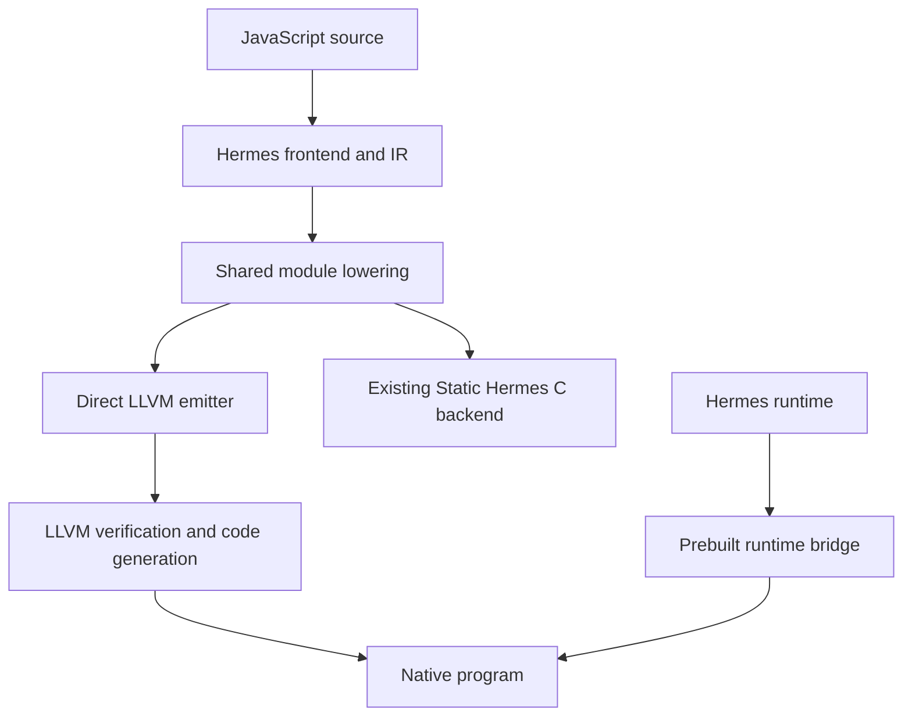
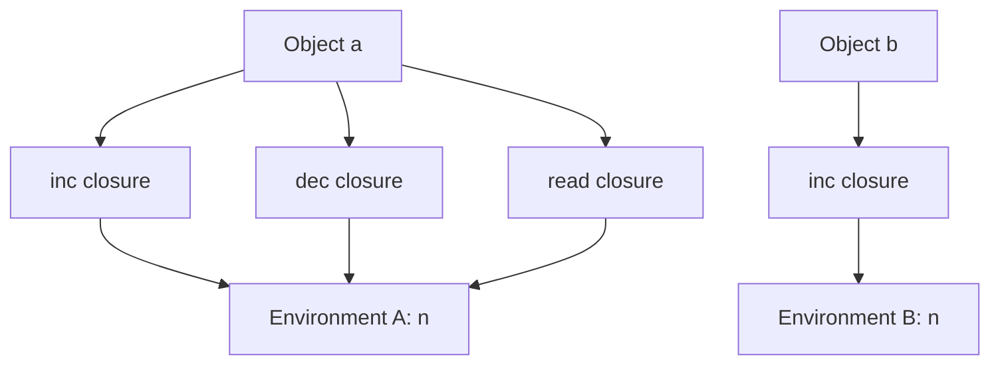

# Direct LLVM compilation for Static Hermes

## 1. What this implementation builds

This chapter follows a JavaScript program from Hermes's intermediate representation to LLVM IR and then to native execution. Its central question is practical: **how can a compiler emit native code for functions, objects, and closures while preserving the language's runtime behavior?** Arithmetic instructions alone are insufficient. A function can return another function, a property access can call a getter, and an allocation can move objects that an earlier expression still needs.

The implementation answers that question by combining a new LLVM emitter with the existing Static Hermes runtime. The emitter generates each program's functions, branches, and calls directly as textual LLVM IR. A small, separately compiled C bridge adapts those calls to Hermes's value representation, object model, environments, call frames, and garbage collector. The bridge is built once for a runtime configuration; a guest program does not become a generated C program on this path. [1] [2] [3]

The source base is the `static_h` development line of Hermes, pinned here to commit `f837b9dd8396ebf5c4e8115412417d273565f0fe`. This chapter describes the accompanying local changes, which are not present in that upstream commit. It explains implemented mechanisms and their constraints; examples are teaching examples, not a claim that every JavaScript feature or every optimization combination has passed validation. Consult the delivered validation records for measured results.

The current dynamic runtime bridge deliberately requires a 64-bit host pointer ABI. The separate PicoCalc prototype compiles its restricted integer worlds directly to RV32 LLVM IR. These are two distinct execution targets. Objects and closures in the host backend do not establish that the dynamic Hermes runtime runs on a physical PicoCalc or ESP32 device. Section 13 explains the remaining integration work.

## 2. Where the compiler changes direction

An **intermediate representation**, or IR, records program operations in a form designed for analysis and transformation. Hermes already parses JavaScript, resolves bindings, constructs functions and basic blocks, and lowers many language constructs. The new backend reuses that work. It does not parse JavaScript again.



The compiler driver's `-emit-llvm` path calls `sh::generateLLVM`. That function invokes `lowerForLLVM`, assigns indices to environment variables, and creates a `ModuleEmitter`. The shared lowering includes argument handling, object literal lowering, scope lowering, switch lowering, constant loading, and selected optimizations. [1] [4]

The boundary matters. The existing C backend subsequently performs its own register allocation and transformations such as call lowering that encode its register choices. The direct backend stops before those stages. LLVM receives a representation from which it can perform its own optimization and machine register allocation. Reusing the C backend's final register-oriented form would unnecessarily couple the new emitter to a different code generator's storage decisions.

| Component | Responsibility |
|---|---|
| `tools/shermes/compile.cpp` | Select direct emission and publish a complete module only after backend success |
| `lib/BCGen/SH/SH.cpp` | Provide the shared module-lowering boundary |
| `LLVMNative/LLVMBackend.cpp` | Translate supported Hermes instructions, functions, control flow, and module data into LLVM text |
| `LLVMNative/runtime.h` | Declare the narrow interface between generated code and runtime adaptation |
| `LLVMNative/runtime.c` | Implement that interface using the actual Static Hermes runtime |
| `utils/shllvm.py` | Assemble, verify, optimize, link or JIT, and record the build inputs |

`ModuleEmitter` assigns function IDs, interns strings, gathers helper declarations, and writes module data. `FunctionEmitter` handles an individual function's blocks, storage, instructions, and exception regions. Imported helper signatures are recorded consistently: a helper cannot silently acquire different LLVM argument types at different call sites. [1]

Text emission keeps the compiler independent of LLVM's C++ library ABI. The tools `llvm-as` and `opt` subsequently check the emitted module. Unsupported Hermes instructions produce diagnostics, and `compileToLLVM` buffers the module before publishing it. This prevents an incomplete translation from looking like successful output. Verification remains a structural check: valid LLVM can still implement the wrong JavaScript behavior.

## 3. Values and the runtime boundary

Generated native JavaScript functions currently have this shape:

```llvm
define internal i64 @shllvm_f7(ptr %shr) {
  ; Generated function body.
}
```

The parameter is a runtime pointer. The returned `i64` holds the bits of a Hermes `SHLegacyValue`. It does **not** mean that every JavaScript value is an integer. Numbers, booleans, undefined, null, and heap references use the runtime's tagged representation. JavaScript arguments arrive through Hermes's register stack, described in Section 6. [1] [2] [5]

Most helpers receive pointers to rooted value slots and place their result into another slot. For example, a dynamic addition passes a result address, runtime pointer, operation code, and two operand addresses to `shllvm_binary`. The bridge then calls Hermes's existing addition implementation. This preserves behaviors such as string concatenation and object-to-primitive conversion without duplicating them in the emitter.

The LLVM-visible interface uses a small vocabulary:

| LLVM type | Meaning in this interface |
|---|---|
| `ptr` | An opaque runtime, frame, unit, native function, or rooted-slot address, according to the helper signature |
| `i64` | Tagged value bits, or an explicitly declared size/bit-pattern field |
| `i32` | Counts, indices, operation selectors, and bridge boolean results |
| `double` | A Number already known to be suitable for floating-point arithmetic |

Opaque pointers do not remove type discipline. Passing a frame address where a rooted value address is expected is still a compiler bug. The discipline resides in the helper prototypes and emitter logic rather than LLVM pointee types.

The bridge computes native structure sizes and accesses C fields. Compile-time assertions require eight-byte values, eight-byte host pointers, and a sixteen-byte function descriptor. These assertions document the present ABI contract; they are not a proof of portability to every 64-bit platform.

Constants also cross this boundary deliberately. Numeric bit patterns become values through `_sh_ljs_untrusted_double`; booleans use the boolean constructor. The internal Empty sentinel has its own representation. Uninit follows the existing SH convention of using undefined bits, while compiler type information retains its distinct role. Consequently, a temporal-dead-zone check carries an explicit invalid-type mask: it must not reject every ordinary JavaScript `undefined`. [1] [2] [5]

## 4. Keeping values alive across allocation

A **garbage-collector root** is a location from which the collector begins tracing live objects. A native machine register containing an object address is not automatically such a location. Moreover, a moving collector can relocate an object and update its registered references. Generated code must subsequently use the updated value.

This backend adopts a conservative storage policy: every Hermes instruction receives a root slot, and encountered constants receive slots too. Side-effect-only instructions also receive unused slots to keep numbering simple. A scratch slot supports temporary helper operations. All slots are initialized to undefined before they are exposed to collection. [1] [2]

At entry, generated code asks `shllvm_frame_size` for the required native storage size, allocates aligned stack storage, and calls `shllvm_enter`. The bridge initializes the `SHLocals` header, links this root frame through `_sh_enter`, and reserves the outgoing Hermes argument/frame area. The emitter obtains the root-array address through `shllvm_roots`; it never guesses the offset of that array inside `SHLocals`.

The resulting invariant is:

> Every guest value that must survive a potentially allocating operation has an authoritative copy in a location traced by Hermes.

A property read can invoke a getter; a conversion can invoke user code; either can allocate. Therefore the emitter treats ordinary runtime helpers as possible safepoints unless their implementation establishes otherwise. After a helper returns, later uses reload their values from root slots. The emitter does not cache a movable heap address in a long-lived LLVM temporary. It also avoids false purity attributes that would tell LLVM these calls cannot modify rooted storage.

Short-lived raw values are permissible between safepoints. A phi-edge transfer, for example, performs only loads and stores. Similarly, argument copying first loads rooted values into an outgoing array, then the bridge copies them without allocation into Hermes's traced register stack before invoking the callee. The temporary array is not a separate collector root table; the copying protocol makes that safe. [1] [2] [6]

Normal return reads the result, removes any function-level exception handler, leaves the runtime frame, and returns its bits. Those cleanup operations do not allocate managed objects. Exceptional unwinding needs a different restoration path, explained in Section 10.

This design favors inspectable correctness over compact frames. Values can remain rooted after their last semantic use, delaying collection until return. Precise liveness, slot reuse, or LLVM stack maps would be later optimizations requiring new proofs. The current admission limit is 1,024 combined root and argument slots, including scratch/minimum argument storage: at most 8 KiB of explicit tagged payload. Headers, exception buffers, machine spills, runtime frames, and recursion consume additional stack. The limit and native stack checks are not a total memory budget.

## 5. Branches and simultaneous phi assignments

A **basic block** contains instructions executed in sequence until its final branch, return, or throw. A conditional Hermes branch becomes a truthiness helper call followed by an LLVM conditional branch. JavaScript truthiness is preserved before LLVM receives its one-bit condition. [1]

Hermes IR also uses phi nodes. A phi selects a value according to the incoming control-flow edge. In this implementation its result lives in a root slot. The emitter inserts an edge block whenever the destination requires phi transfers.

Consider a loop whose next iteration exchanges two values:

```text
next_a = old_b
next_b = old_a
```

Writing `a = b` and then `b = a` into the same storage loses `old_a`. Both phi assignments logically occur together. `emitEdges` therefore loads **all incoming values first**, then stores all destination slots:

```llvm
edge_example:
  %old_a = load i64, ptr %a, align 8
  %old_b = load i64, ptr %b, align 8
  store i64 %old_b, ptr %a, align 8
  store i64 %old_a, ptr %b, align 8
  br label %loop
```

This is schematic explanatory IR, not an extracted module. There are no allocating calls between these transfers. Thus the raw temporaries remain valid, and cycles among phi assignments cannot overwrite their own inputs. The same edge mechanism handles phi transfers into exception destinations. LLVM's phi definition supplies the general control-flow semantics; the rooted-slot strategy is this backend's implementation choice. [1] [9]

## 6. Calling functions, passing `this`, and constructing objects

Although a generated function takes one LLVM parameter, a JavaScript call has a callee, arguments, `this`, and sometimes `new.target`. `emitCall` gathers explicit arguments into a contiguous array. `shllvm_call` places the callee, receiver, construction target, and arguments into the outgoing Hermes frame, then invokes `_sh_ljs_call`. Hermes owns the remaining call metadata and dispatch. [1] [2] [6]

`shllvm_param` reads incoming parameters using the runtime's established numbering: index zero is `this`, and explicit parameters begin at one. Missing parameters produce undefined. Recursion creates new native/root frames, while each invoked closure still identifies its own captured environment.

This distinction explains method calls. In `object.method(3)`, the function value and receiver are different pieces of call information. Extracting the same method into a variable can change the receiver on a later call. The frontend represents this distinction, and the bridge preserves it. Non-strict receiver coercion has its own helper; an arrow's lexical `this` comes from the frontend's capture representation, rather than a special rule invented by the call bridge.

Construction also uses the existing protocol. Helpers implement `CreateThis`, `GetNewTarget`, and selection between the allocated receiver and an explicit object returned by the constructor. Function metadata distinguishes permitted invocation forms: an arrow cannot be constructed, and a class constructor cannot be called as an ordinary function. The generated prologue checks these restrictions.

Class creation delegates to `_sh_ljs_create_class`, passing the native function, its environment and metadata, the home-object output, and an optional superclass. Receiver-sensitive property helpers support operations whose lookup object differs from their receiver. These mechanisms describe the implemented path; they do not imply that every class extension, such as private-field lowering, is accepted. Argument objects likewise retain Hermes's lazy/reified and strict/loose helper paths. [1] [2] [5]

## 7. Closures are code plus shared bindings

A **closure** packages executable code with the lexical environment needed by that code. A captured binding is a mutable cell in an environment, not necessarily a copy of the value present when the function was created.

Consider this excerpt from `test/LLVMNative/closures.js`:

```javascript
function counter(start) {
  let n = start;
  return {
    inc: () => ++n,
    dec: function () { return --n; },
    read: () => n
  };
}
const a = counter(40), b = counter(100);
print(a.inc(), a.inc(), a.dec(), a.read(), b.inc(), a.read());
```

The expected output, derived from the source, is `41 42 41 41 101 41`. `a.inc`, `a.dec`, and `a.read` share the same binding for `n`. The second invocation creates a separate binding for `b`. Incrementing `b` cannot change `a`.



The implementation maps each part to existing Hermes operations. `CreateScopeInst` calls `shllvm_env_create`. Variable indices assigned after lowering identify the environment slots. `StoreFrameInst` writes a slot through `shllvm_env_store`; `LoadFrameInst` reads it through `shllvm_env_load`. The store uses Hermes's write barrier, allowing the collector to track newly stored heap references. [1] [2] [5]

`CreateFunctionInst` calls `shllvm_closure`, which creates a real Hermes function object containing the generated native function pointer, metadata, compilation unit, and environment. At invocation, the callee recovers its environment from the current closure. Scope-resolution helpers walk parent environments for captures from more distant lexical scopes.

The creator's native frame can disappear while the environment survives. In the example, the returned object retains the closures, and those closures retain Environment A. That reachability, not the stack frame of `counter`, keeps `n` alive. The absent-environment case is handled explicitly as undefined/null helper input; the bridge must not fabricate an object-tagged null address and present it to the collector.

Nested arrows such as `a => b => c => a + b + c` extend this chain. Each invocation can introduce a new environment, and the innermost closure reaches the required outer bindings. Recursive closures add another useful case:

```javascript
function recursiveClosure() {
  let f = n => n === 0 ? 0 : n + f(n - 1);
  return f;
}
print(recursiveClosure()(20)); // Expected mathematically: 210.
```

Here the captured `f` slot refers to a closure that itself refers to the environment containing `f`. A tracing collector can handle this cycle. The compiler must preserve shared-cell access rather than substitute an incomplete snapshot during closure creation.

There are two lifetimes to distinguish. Heap reachability controls closure/environment lifetime. The native code mapping and `SHUnit` metadata must also remain available whenever a closure can execute. Upstream specifies that a unit, once associated with a runtime, persists until that runtime is destroyed. Unloading code while a surviving closure points to it violates a different contract that garbage collection alone cannot repair. [5]

## 8. Objects, properties, arrays, and observable order

Objects are allocated by Hermes. The emitter uses helpers for named or computed reads, assignment, defining own properties, accessors, and deletion. Named operations use interned symbol IDs and per-string property caches; computed operations pass a rooted key value. A cache accelerates the runtime's lookup protocol without replacing its semantic checks. [1] [2]

Assignment and definition are distinct. Assigning a property may invoke an inherited setter; defining an own property creates or changes a property on the object itself. Strict and non-strict writes also differ in failure behavior. The emitter chooses corresponding helper variants, including operations with an explicit receiver. The `try_flag` on global-property helpers concerns errors for missing global bindings, not JavaScript `try` syntax.

Object literals lowered into buffers are expanded into ordinary allocation and property definitions in this first backend. Where the lowered IR contains named fixed-property operations, the emitter preserves the property name instead of assuming the optimized C backend's storage offsets. Explicit prototypes use the runtime's parent-aware allocation helper and a registered empty-shape cache. Typed object allocation and private fixed-slot properties are rejected rather than silently translated with ordinary object semantics.

Arrays require a subtle distinction:

```javascript
const hole = [,];
const present = [undefined];
print(0 in hole, 0 in present); // Expected: false true.
```

Both arrays have length one, but only the second owns an element at index zero. The emitter allocates the logical array length and skips `LiteralEmpty` entries. It still defines an element whose value is undefined. Nonliteral element stores already introduced by frontend lowering remain in their IR order. This preserves the frontend's evaluation sequence rather than recomputing expressions during allocation. [1] [2] [7]

These are also memory-management concerns. A getter, setter, conversion, or array callback can reenter generated JavaScript. Root frames, environments, outgoing arguments, and code mappings must remain valid across that nested execution.

## 9. Dynamic arithmetic and direct floating-point operations

The backend has two arithmetic paths. General JavaScript operations call Hermes helpers, which preserve coercion and exception behavior. An addition with an unknown operand type cannot simply become LLVM `fadd`: it might concatenate strings or run user code during conversion. [1] [2]

When Hermes IR already contains a floating operation, the emitter loads its known numeric operands, bitcasts their value bits to `double`, and emits `fadd`, `fsub`, `fmul`, `fdiv`, `frem`, or `fneg`. Results pass through `shllvm_number`, which uses the runtime's untrusted-double constructor before they become tagged values again.

The emitter attaches **no fast-math flags**. JavaScript exposes signed zero, infinities, and NaN-related behavior, so transformations requiring assumptions about their absence would need a stronger justification. Floating comparisons use ordered predicates for equality and ordering, and unordered-or-not-equal for inequality: `oeq`, `olt`, `ole`, `ogt`, `oge`, and `une`. This gives the intended NaN behavior for the typed comparison operations. [1] [9]

For example, a compiler must preserve the distinction between `1 / 0` and `1 / -0`, and must not turn `NaN !== NaN` into false. The root-slot representation does not itself enforce these rules; correct operation selection and the runtime's numeric constructor do. Likewise, bitwise JavaScript operations retain their runtime conversion rules rather than applying integer instructions directly to arbitrary tagged values.

## 10. Exceptions and a function-local nonlocal return

The current implementation reuses Hermes's setjmp/longjmp exception convention. It does not introduce a separate LLVM `invoke`/landing-pad exception model. A function containing lexical try regions installs one native `SHJmpBuf` and uses a small state variable to identify the active region. [1] [2] [5]

The setup is deliberate:

1. Ask the bridge for the target's `sizeof(SHJmpBuf)` and allocate aligned storage.
2. Initialize a volatile `try_state` to zero, meaning no active lexical handler.
3. Call `shllvm_try_begin` to link the buffer and obtain its native jump-buffer address.
4. Call `_setjmp` **inside the generated function**, with `returns_twice` on its LLVM declaration and call.
5. Continue normally for zero; dispatch a caught exception for a nonzero result.

Placing setjmp in a helper that returns would be incorrect: a later longjmp would attempt to resume an activation that has already ended. The bridge prepares the buffer, but the generated function owns the continuation point. LLVM's `returns_twice` attribute informs optimization about this unusual return behavior. [9]

`TryStartInst` writes its nonzero region ID. `TryEndInst` restores the enclosing region or zero. A `CatchInst` similarly establishes the enclosing handler and retrieves/clears the pending exception. Source-level finally behavior has already been expressed by the frontend's control flow; the emitter follows that graph, including paths through return, break, and continue.

On exceptional return, the dispatcher reads `try_state` and calls `shllvm_catch_prepare` with the function's **root-frame storage**, incoming frame, and outgoing argument capacity. This delegates to `_sh_catch_no_pop`, restoring runtime root/register-stack state after intervening calls have unwound. A switch then chooses the matching catch edge, including any required phi transfers. State zero follows a pop-and-rethrow path to an enclosing function's handler. [1] [2]

The emitter makes its ordinary raw value loads and stores volatile in functions containing try regions, including phi stores. Together with memory-resident state and `returns_twice`, this conservatively preserves mutations needed after a nonlocal return. Volatile is not a collector, a synchronization mechanism, or an independent proof of exception correctness.

Exception tests should examine more than a thrown integer. An exception object can retain a lambda; a finally block can replace a pending return; a nested handler can rethrow after updating a captured variable. The `exceptions.js` fixture illustrates these interactions. They exercise the relationship between language control flow, native continuation state, and heap reachability rather than just one branch instruction.

## 11. Compilation units and stable descriptors

Generated code needs data as well as function bodies. `ModuleEmitter` produces ASCII and UTF-16 pools, string records containing offset/length/hash, a unit-index global, and function descriptors. UTF-16 conversion preserves surrogate code units, and the high offset bit distinguishes the non-ASCII pool. [1] [5]

Function descriptors use an intentionally simple boundary format:

```llvm
%SHLLVMFunctionInfo = type { i32, i32, i32, i32 }
```

The fields hold the name index, expected explicit argument count, function kind, and invocation prohibition. Native `SHNativeFuncInfo` contains C bitfields. The bridge copies descriptor fields into that structure using compiled C assignments; the LLVM emitter never guesses the target compiler's bitfield layout. [2] [3]

`sh_export_<unitName>` constructs the unit, which owns runtime symbol/cache arrays and native function metadata. Generated string pools and code pointers remain referenced by that unit. When requested, a generated `main` calls `shllvm_run`, which checks the runtime model, initializes Hermes and console bindings, initializes the unit, runs the event loop, and performs cleanup. This provides a host executable lifecycle, not a device scheduler or hot-reload manager.

## 12. Reading and running the generated program

The following commands assume a configured `build-llvm` directory with `shermes` built, matching LLVM tools available, and execution from the repository root. Set `LLVM_BIN` to your LLVM installation's `bin` directory if those tools are not otherwise discoverable. The commands are reproducible exercises; their inclusion is not a report of a particular validation run. [8]

```sh
# Preserve easily inspected IR: minimize both optimization stages.
python3 utils/shllvm.py emit --build-dir build-llvm \
  --hermes-opt O0 --llvm-opt 0 \
  -o build-llvm/lesson/closures.ll test/LLVMNative/closures.js

# Compile, link, and execute a native program.
python3 utils/shllvm.py run --build-dir build-llvm \
  -o build-llvm/lesson/closures test/LLVMNative/closures.js

# Execute the verified bitcode through host LLVM lli.
python3 utils/shllvm.py jit --build-dir build-llvm \
  -o build-llvm/lesson/closures-jit test/LLVMNative/closures.js
```

The driver enables ES6 block scoping and temporal-dead-zone checks, emits `.ll`, assembles it, verifies it, and applies the selected LLVM optimization pipeline with verification. It publishes the readable IR and optimized `.bc` after successful processing. Native builds link the static bridge archive plus Hermes libraries; JIT execution loads the shared bridge into `lli`. Neither path regenerates C for the guest program. The native executable still depends on its runtime libraries and build configuration.

Direct `shermes -emit-llvm` invocation also enables block scoping and TDZ checks by default, while respecting explicit `-Xes6-block-scoping=false` and `-Xenable-tdz=false` overrides. The existing C-emission oracle needs the corresponding enabled flags for comparison. These checks retain the pinned upstream frontend's language restrictions: the supplied reassignment-to-`const` example is rejected during compilation, and a statically provable read before lexical initialization can also be rejected even inside `try`. Standard JavaScript can instead expose catchable runtime errors in those examples. Closure-mediated runtime TDZ checks are exercised separately; enabling TDZ does not establish complete ECMAScript acceptance. The distinction is recorded in [the lexical-default checks](evidence/lexical-defaults-validation.json) and [the differential results](evidence/validation.json).

The adjacent `.build.json` records source/IR hashes, the bridge hash where available, commands, optimization choices, sanitizer configuration, and `program_c_generation: false`. This helps connect a result to its actual inputs. The external `lli` path is host execution, not an embedded ORC integration or an RV32 emulator. A subprocess timeout limits a run from outside; it is not an instruction-fuel mechanism within generated code. [8] [10] [11]

## 13. Connecting the host backend to PicoCalc

The PicoCalc integer-world lane has a fixed state structure, a capability-call ABI, and an RV32 instruction interpreter. Its direct emitter can preserve that contract without introducing a dynamic heap. The Hermes lane introduces managed objects, closure environments, runtime services, and native code lifetimes. The integration chapter documents these separate contracts in detail. [12]

A defensible initial dynamic-world design gives each generation its own runtime. The host prepares a candidate, serializes explicitly supported application state into it, checks migration, and switches event delivery only after success. Old code remains mapped until no invocation or retained callback can reach it. Raw Hermes values, environment addresses, and native function pointers are unsuitable as a cross-runtime state format.

Several device tasks remain substantive engineering work: establish the RV32 value/callback ABI, port required allocation and exception services, provide double-precision support appropriate to the target, validate collector roots and barriers, manage executable memory/cache synchronization, and connect capability effects to the world's transaction protocol. Removing the bridge's 64-bit assertion accomplishes none of those tasks.

Heap rollback and scheduling also need explicit policies. Canceling display effects does not undo mutations already made to a Hermes object. A GC safepoint is not automatically a fuel check. LLVM's ability to emit RISC-V instructions therefore supplies one compilation component, while runtime portability and world supervision remain separate obligations. [12] [13]

## 14. Laboratory exercises and evidence

Use the exercises below to connect the implementation to observable behavior. Record tool versions, command lines, hashes, expected output, actual output, and any failure before drawing conclusions.

1. **Shared and independent captures.** Extend `counter` with a reset method. Predict results for two counters and several retained methods. Inspect emitted calls to environment load/store helpers, then compare native and JIT behavior.
2. **Parallel phi transfers.** Write a loop that rotates three values. Find its edge blocks in minimally optimized IR. Explain which inputs would be lost by interleaving loads and stores. Compare multiple optimization levels.
3. **Property effects and holes.** Combine a getter that logs access with an array containing a hole and an explicit undefined. Predict both output order and `in` results before running it.
4. **Exceptions and captures.** Throw an object containing a closure; update its captured variable in finally; call it in an outer catch. Trace handler-state changes and explain which roots retain the environment.
5. **An unsupported construct.** Compile an existing negative fixture and verify that it fails with a diagnostic. Preserve an old output file and check that failed emission does not replace it with partial IR.

Each technique answers a different question. LLVM verification checks IR structure. Differential execution against an independent JavaScript implementation checks selected observable semantics. Collector stress checks root/lifetime assumptions. Sanitizers can expose native memory mistakes. None alone proves complete language conformance, and passing a host test does not demonstrate device execution. Future optimizations should preserve these distinctions while reducing root traffic, metadata overhead, or redundant runtime calls.

## References and source-reading guide

Local links identify the implementation accompanying this chapter. Upstream links are pinned to the base commit so that the reused contracts remain reviewable. LLVM links use the LLVM 18 documentation family; consult the installed tool's version when reproducing a build.

1. [Direct emitter: `LLVMBackend.cpp`][1]. Read `FunctionEmitter::generate`, `emitInstruction`, `emitEdges`, and `ModuleEmitter::emitData` together.
2. [Runtime adaptation: `runtime.c`][2]. Follow `shllvm_enter`, `shllvm_call`, environment helpers, exception helpers, and `shllvm_create_unit`.
3. [Bridge interface: `runtime.h`][3]. Defines the fixed descriptors and helper signatures.
4. [Upstream Static Hermes lowering and C emission][4]. Compare `lowerModuleIR` with later register-specific transformations; the local file adds `lowerForLLVM`.
5. [Upstream Static Hermes public runtime contract][5]. Contains `SHUnit`, `SHLocals`, function metadata, value helpers, and exception entry points.
6. [Upstream Hermes stack-frame layout][6]. Explains the call-frame indices preserved by the bridge.
7. [Upstream lowering implementation][7]. Provides context for object/array and other instruction transformations.
8. [Build and execution driver: `utils/shllvm.py`][8]. Its commands and manifests define the reproducible workflow.
9. [LLVM 18 Language Reference][9]. Consult phi nodes, floating comparisons, fast-math flags, volatile accesses, and `returns_twice`.
10. [LLVM 18 `lli` guide][10]. Describes host bitcode execution.
11. [LLVM 18 `opt` guide][11]. Describes optimization and verification tooling.
12. [PicoCalc integration and remaining port work][12]. Separates integer-world evidence from dynamic host-runtime execution.
13. [LLVM RISC-V target documentation][13]. Describes backend target considerations rather than a JavaScript runtime port.

[1]: ../../lib/BCGen/SH/LLVMNative/LLVMBackend.cpp
[2]: ../../lib/BCGen/SH/LLVMNative/runtime.c
[3]: ../../lib/BCGen/SH/LLVMNative/runtime.h
[4]: https://github.com/facebook/hermes/blob/f837b9dd8396ebf5c4e8115412417d273565f0fe/lib/BCGen/SH/SH.cpp
[5]: https://github.com/facebook/hermes/blob/f837b9dd8396ebf5c4e8115412417d273565f0fe/include/hermes/VM/static_h.h
[6]: https://github.com/facebook/hermes/blob/f837b9dd8396ebf5c4e8115412417d273565f0fe/include/hermes/VMLayouts/sh_stack_frame_layout.h
[7]: https://github.com/facebook/hermes/blob/f837b9dd8396ebf5c4e8115412417d273565f0fe/lib/BCGen/Lowering.cpp
[8]: ../../utils/shllvm.py
[9]: https://releases.llvm.org/18.1.8/docs/LangRef.html
[10]: https://releases.llvm.org/18.1.8/docs/CommandGuide/lli.html
[11]: https://releases.llvm.org/18.1.8/docs/CommandGuide/opt.html
[12]: PICOCALC_INTEGRATION.md
[13]: https://llvm.org/docs/RISCVUsage.html
