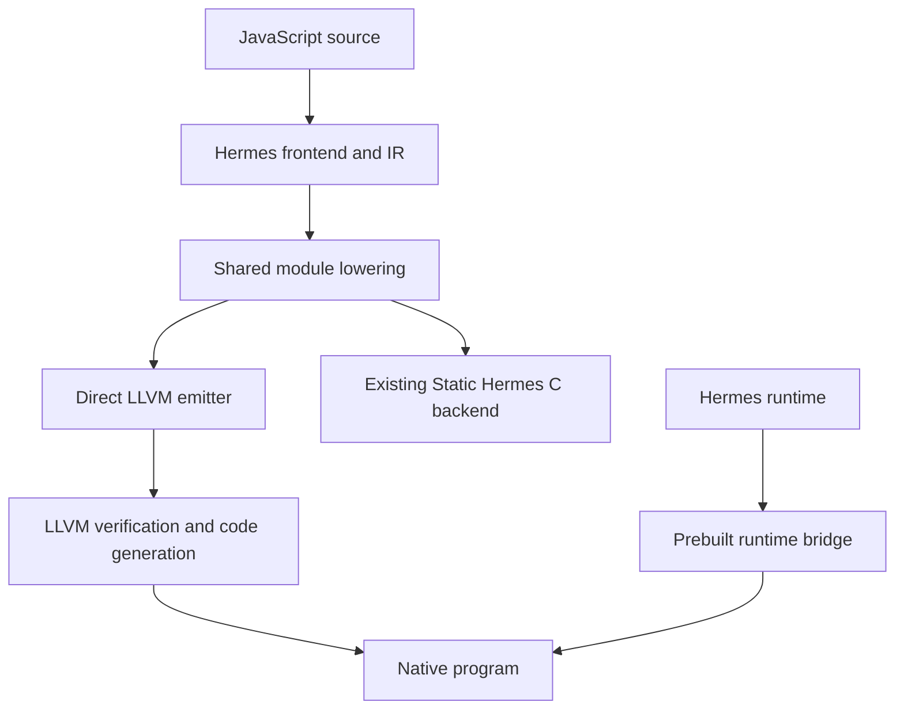
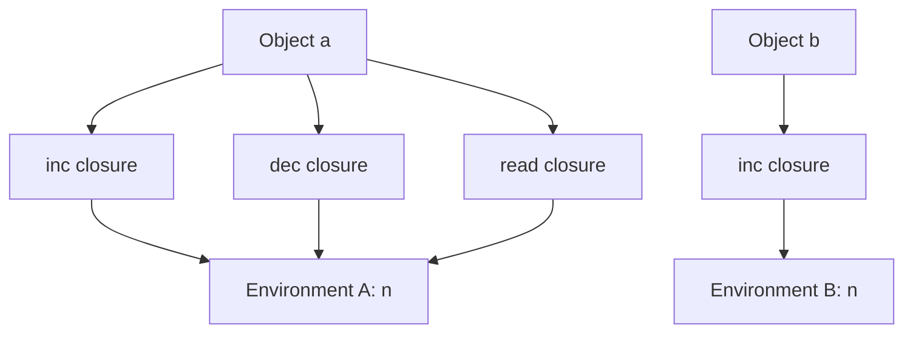

# Direct LLVM Implementation: JavaScript Language Extensions and PicoCalc

Technical report and undergraduate compiler laboratory. 28 October 2026.

# 1. What was implemented

## 1.1 The result

This release adds a working direct LLVM backend to Static Hermes and updates the earlier PicoCalc integer-world compiler to emit LLVM IR directly. The host backend includes functions, objects, escaping lambdas, mutable captures, constructors, classes and exceptions. This extension adds generators, async/await, Promise validation and runtime corrections, RegExp literals, BigInt, private fields, typed arrays, and lexical evaluation support. It runs against the actual Hermes runtime on Linux x86-64, including LLVM's `lli` JIT. The smaller PicoCalc backend generates RV32IM code and preserves the existing simulated world's transaction and generation protocol.

The distinction between these two targets is essential. The host backend supplies the dynamic language mechanisms requested in this update. The device-oriented prototype supplies a bounded integer ABI and an RV32 execution environment. They are both implemented, but the host's managed JavaScript heap has not been ported into the device world. No physical PicoCalc or ESP32-P4 execution is claimed.

The source baseline is Facebook's Static Hermes branch at commit `f837b9dd8396ebf5c4e8115412417d273565f0fe`. The accompanying patch adds the direct emitter and its integration; the pinned upstream commit alone does not contain these changes. The release includes a complete source snapshot, a patch that applies to that exact base, test fixtures, raw validation records, this report's Markdown source, and a detailed engineering diary.

## 1.2 What "direct to LLVM" means

The previous Static Hermes path translated Hermes IR into C, then relied on a C compiler to translate that program into LLVM IR and machine code. The new path translates Hermes IR into LLVM IR itself. The JavaScript frontend, semantic analysis, and useful module lowering remain; the program-specific C representation and C parser stage are removed.

A fixed C bridge remains as part of the runtime implementation. It is compiled once for a particular runtime configuration. This bridge implements stable entry points for tagged values, root frames, environments, object operations, calls and compilation units. A C++ lexical-eval helper is built into the full Hermes VM. Calling this prebuilt runtime from generated LLVM does not regenerate a C translation of each guest program. Dynamically supplied eval/Function strings use Hermes's bytecode compiler; runtime LLVM compilation of those strings is not claimed.

The first implementation emits textual `.ll` files. LLVM still parses those files, verifies their structure, optimizes them, and emits native code. This choice makes the translation inspectable in a teaching laboratory and avoids linking the compiler frontend to LLVM's C++ libraries. An in-memory LLVM API or bitcode writer could remove the textual IR parsing step later, after the runtime contracts are stable. The current implementation makes no measured compilation-speed or execution-speed claim.

## 1.3 Feature map

The table names mechanisms exercised by the delivered tests. It is a feature inventory for this release, not a full ECMAScript conformance statement. Chapter 3 explains exactly how the evidence was collected.

| Area | Implemented and exercised examples | Source to inspect |
|---|---|---|
| Functions | Named functions, recursive factorial, mutual recursion, higher-order and indirect calls | `functions.js`; `emitCall`; `shllvm_call` |
| Lambdas and closures | Arrows and function expressions; escaping, nested, recursive and shared mutable captures | `closures.js`; environment helpers |
| Lexical bindings | Per-iteration loop capture; closure-mediated temporal dead zones | `lexical_tdz.js`; compiler-default checks |
| Objects | Literals, computed keys, own-property definition, identity, cycles, getters and setters | `objects.js`; `accessors.js` |
| Arrays | Literal holes, indexed mutation, and callbacks into generated functions | `arrays_callbacks.js` |
| Invocation rules | `this`, lexical arrow receiver, arguments, constructors, `new.target` and rejected arrow construction | `arrows_this.js`; `arguments.js`; `constructors.js` |
| Classes | Ordinary inheritance, `super`, getters, captured receiver, `instanceof` and static inheritance | `classes.js` |
| Control and exceptions | Branches, loops, phi transfers, nested catch/finally, return and loop control through finally | `control_phi.js`; `exceptions.js` |
| Dynamic values | Strings, UTF-16 data, coercion, arithmetic and runtime error classes | `strings.js`; `coercion.js`; error fixtures |
| Collection | Escaping closures retain live state after allocation churn and explicit collection | `gc_closures.js` |
| Generators | Next/throw/return, yield-star delegation, suspended finally clauses, iterator cleanup and collection | `generator_*.js`; `shllvm_generator` |
| Async and Promises | Await, thenables, jobs, rejection, combinators, species, async-generator queues and cleanup | `async_*.js`; `promise_*.js` |
| Rich values | Exact BigInt literals, RegExp literals, private names/fields/methods, buffers and typed arrays | `features_*.js`; `value_extensions.c` |
| Dynamic source | Global eval, Function and direct eval from strict callers sharing native environment cells | `eval_*.js`; `function_*.js`; `eval_extensions.cpp` |
| Device world | Direct LLVM integer code, capability ecalls, bounded RV32 execution, transactional reload | PicoCalc compiler and supervisor tests |

Original host fixtures are in `hermes/test/LLVMNative/`. Extension fixtures are in `hermes/test/LLVMNativeExtensions/`. The direct-eval boundaries and precise test contracts are described in Chapters 3 and 7.

## 1.4 A complete worked program

The runnable example `hermes/examples/llvm/counter.js` combines the requested features. A counter object contains three lambdas. The lambdas share a mutable binding; a second counter receives a different binding. A higher-order function produces an array callback. A class returns an arrow that keeps its receiver, and an exception object carries another retained function.

```javascript
// A native-compiled closure shares a mutable environment with its siblings.
function makeCounter(initial) {
  let value = initial;
  return {
    add: delta => { value += delta; return value; },
    read: () => value,
    snapshot: () => ({ value, description: "captured state" })
  };
}

const first = makeCounter(40);
const second = makeCounter(100);
print(first.add(1), first.add(1), first.read(), second.add(5));
print(JSON.stringify(first.snapshot()));

// A function can return a function, and ordinary array methods call it back.
function multiplyBy(scale) {
  return value => value * scale;
}
print([1, 2, 3].map(multiplyBy(7)).join(","));

// Constructors, inheritance, methods and lexical arrow this use the same
// runtime calling convention as plain source functions.
class CounterView {
  constructor(counter) { this.counter = counter; }
  reader() { return () => this.counter.read(); }
}
const readLater = new CounterView(first).reader();
first.add(8);
print(readLater());

// Exception edges preserve committed captured state.
try {
  first.add(2);
  throw { reason: "example", read: first.read };
} catch (error) {
  print(error.reason, error.read());
}
```

The native executable and the `lli` JIT produced the same output:

```text
41 42 42 105
{"value":42,"description":"captured state"}
7,14,21
50
example 52
```

The first line is a compact closure test. Both updates and the read through `first` reach the same environment, giving 41, 42, and 42. The other counter's update produces 105 independently. The snapshot creates a new ordinary object containing the current value. The array result demonstrates a returned function used as a callback. The value 50 confirms that the method's returned arrow can still find the counter after the method returns. Finally, the caught object retains a read closure and observes the later value 52.

The output is recorded evidence, not merely an expected result inferred from the example. Its native and JIT logs are `docs/llvm/evidence/counter-native.txt` and `counter-jit.txt`. The corresponding generated modules and build manifests can be reproduced with the driver in Chapter 5.


# 2. Architecture and implementation

## 2.1. What this implementation builds

This chapter follows a JavaScript program from Hermes's intermediate representation to LLVM IR and then to native execution. Its central question is practical: **how can a compiler emit native code for functions, objects, and closures while preserving the language's runtime behavior?** Arithmetic instructions alone are insufficient. A function can return another function, a property access can call a getter, and an allocation can move objects that an earlier expression still needs.

The implementation answers that question by combining a new LLVM emitter with the existing Static Hermes runtime. The emitter generates each program's functions, branches, and calls directly as textual LLVM IR. A small, separately compiled C bridge adapts those calls to Hermes's value representation, object model, environments, call frames, and garbage collector. The bridge is built once for a runtime configuration; a guest program does not become a generated C program on this path. [1] [2] [3]

The source base is the `static_h` development line of Hermes, pinned here to commit `f837b9dd8396ebf5c4e8115412417d273565f0fe`. This chapter describes the accompanying local changes, which are not present in that upstream commit. It explains implemented mechanisms and their constraints; examples are teaching examples, not a claim that every JavaScript feature or every optimization combination has passed validation. Consult the delivered validation records for measured results.

The current dynamic runtime bridge deliberately requires a 64-bit host pointer ABI. The separate PicoCalc prototype compiles its restricted integer worlds directly to RV32 LLVM IR. These are two distinct execution targets. Objects and closures in the host backend do not establish that the dynamic Hermes runtime runs on a physical PicoCalc or ESP32 device. Section 2.13 explains the remaining integration work.

## 2.2. Where the compiler changes direction

An **intermediate representation**, or IR, records program operations in a form designed for analysis and transformation. Hermes already parses JavaScript, resolves bindings, constructs functions and basic blocks, and lowers many language constructs. The new backend reuses that work. It does not parse JavaScript again.



The compiler driver's `-emit-llvm` path calls `sh::generateLLVM`. That function invokes `lowerForLLVM`, assigns indices to environment variables, and creates a `ModuleEmitter`. The shared lowering includes argument handling, object literal lowering, scope lowering, switch lowering, constant loading, and selected optimizations. [1] [4]

The boundary matters. The existing C backend subsequently performs its own register allocation and transformations such as call lowering that encode its register choices. The direct backend stops before those stages. LLVM receives a representation from which it can perform its own optimization and machine register allocation. Reusing the C backend's final register-oriented form would unnecessarily couple the new emitter to a different code generator's storage decisions.

| Component | Responsibility |
|---|---|
| `tools/shermes/compile.cpp` | Select direct emission and publish a complete module only after backend success |
| `lib/BCGen/SH/SH.cpp` | Provide the shared module-lowering boundary |
| `LLVMNative/LLVMBackend.cpp` | Translate supported Hermes instructions, functions, control flow, and module data into LLVM text |
| `LLVMNative/runtime.h` | Declare the narrow interface between generated code and runtime adaptation |
| `LLVMNative/runtime.c` | Implement that interface using the actual Static Hermes runtime |
| `utils/shllvm.py` | Assemble, verify, optimize, link or JIT, and record the build inputs |

`ModuleEmitter` assigns function IDs, interns strings, gathers helper declarations, and writes module data. `FunctionEmitter` handles an individual function's blocks, storage, instructions, and exception regions. Imported helper signatures are recorded consistently: a helper cannot silently acquire different LLVM argument types at different call sites. [1]

Text emission keeps the compiler independent of LLVM's C++ library ABI. The tools `llvm-as` and `opt` subsequently check the emitted module. Unsupported Hermes instructions produce diagnostics, and `compileToLLVM` buffers the module before publishing it. This prevents an incomplete translation from looking like successful output. Verification remains a structural check: valid LLVM can still implement the wrong JavaScript behavior.

## 2.3. Values and the runtime boundary

Generated native JavaScript functions currently have this shape:

```llvm
define internal i64 @shllvm_f7(ptr %shr) {
  ; Generated function body.
}
```

The parameter is a runtime pointer. The returned `i64` holds the bits of a Hermes `SHLegacyValue`. It does **not** mean that every JavaScript value is an integer. Numbers, booleans, undefined, null, and heap references use the runtime's tagged representation. JavaScript arguments arrive through Hermes's register stack, described in Section 2.6. [1] [2] [5]

Most helpers receive pointers to rooted value slots and place their result into another slot. For example, a dynamic addition passes a result address, runtime pointer, operation code, and two operand addresses to `shllvm_binary`. The bridge then calls Hermes's existing addition implementation. This preserves behaviors such as string concatenation and object-to-primitive conversion without duplicating them in the emitter.

The LLVM-visible interface uses a small vocabulary:

| LLVM type | Meaning in this interface |
|---|---|
| `ptr` | An opaque runtime, frame, unit, native function, or rooted-slot address, according to the helper signature |
| `i64` | Tagged value bits, or an explicitly declared size/bit-pattern field |
| `i32` | Counts, indices, operation selectors, and bridge boolean results |
| `double` | A Number already known to be suitable for floating-point arithmetic |

Opaque pointers do not remove type discipline. Passing a frame address where a rooted value address is expected is still a compiler bug. The discipline resides in the helper prototypes and emitter logic rather than LLVM pointee types.

The bridge computes native structure sizes and accesses C fields. Compile-time assertions require eight-byte values, eight-byte host pointers, and a sixteen-byte function descriptor. These assertions document the present ABI contract; they are not a proof of portability to every 64-bit platform.

Constants also cross this boundary deliberately. Numeric bit patterns become values through `_sh_ljs_untrusted_double`; booleans use the boolean constructor. The internal Empty sentinel has its own representation. Uninit follows the existing SH convention of using undefined bits, while compiler type information retains its distinct role. Consequently, a temporal-dead-zone check carries an explicit invalid-type mask: it must not reject every ordinary JavaScript `undefined`. [1] [2] [5]

## 2.4. Keeping values alive across allocation

A **garbage-collector root** is a location from which the collector begins tracing live objects. A native machine register containing an object address is not automatically such a location. Moreover, a moving collector can relocate an object and update its registered references. Generated code must subsequently use the updated value.

This backend adopts a conservative storage policy: each Hermes instruction whose result has IR users receives its own root slot, and encountered constants receive slots too. Unused produced values share a separate rooted discard slot while their instruction is emitted; side-effect-only instructions need no result storage. A distinct scratch slot supports temporary helper operations. All slots are initialized to undefined before they are exposed to collection. [1] [2]

At entry, generated code asks `shllvm_frame_size` for the required native storage size, allocates aligned stack storage, and calls `shllvm_enter`. The bridge initializes the `SHLocals` header, links this root frame through `_sh_enter`, and reserves the outgoing Hermes argument/frame area. The emitter obtains the root-array address through `shllvm_roots`; it never guesses the offset of that array inside `SHLocals`.

The resulting invariant is:

> Every guest value that must survive a potentially allocating operation has an authoritative copy in a location traced by Hermes.

A property read can invoke a getter; a conversion can invoke user code; either can allocate. Therefore the emitter treats ordinary runtime helpers as possible safepoints unless their implementation establishes otherwise. After a helper returns, later uses reload their values from root slots. The emitter does not cache a movable heap address in a long-lived LLVM temporary. It also avoids false purity attributes that would tell LLVM these calls cannot modify rooted storage.

Short-lived raw values are permissible between safepoints. A phi-edge transfer, for example, performs only loads and stores. Similarly, argument copying first loads rooted values into an outgoing array, then the bridge copies them without allocation into Hermes's traced register stack before invoking the callee. The temporary array is not a separate collector root table; the copying protocol makes that safe. [1] [2] [6]

Normal return reads the result, removes any function-level exception handler, leaves the runtime frame, and returns its bits. Those cleanup operations do not allocate managed objects. Exceptional unwinding needs a different restoration path, explained in Section 2.10.

This design favors inspectable correctness over compact frames. Used values can remain rooted after their last semantic use, delaying collection until return. General liveness-based slot reuse or LLVM stack maps would be later optimizations requiring new proofs. The discard slot removes unnecessary storage without merging independently used SSA values. The current admission limit is 1,024 combined root and argument slots, including scratch, discard and minimum argument storage: at most 8 KiB of explicit tagged payload. Headers, exception buffers, machine spills, runtime frames, and recursion consume additional stack. The limit and native stack checks are not a total memory budget.

## 2.5. Branches and simultaneous phi assignments

A **basic block** contains instructions executed in sequence until its final branch, return, or throw. A conditional Hermes branch becomes a truthiness helper call followed by an LLVM conditional branch. JavaScript truthiness is preserved before LLVM receives its one-bit condition. [1]

Hermes IR also uses phi nodes. A phi selects a value according to the incoming control-flow edge. In this implementation its result lives in a root slot. The emitter inserts an edge block whenever the destination requires phi transfers.

Consider a loop whose next iteration exchanges two values:

```text
next_a = old_b
next_b = old_a
```

Writing `a = b` and then `b = a` into the same storage loses `old_a`. Both phi assignments logically occur together. `emitEdges` therefore loads **all incoming values first**, then stores all destination slots:

```llvm
edge_example:
  %old_a = load i64, ptr %a, align 8
  %old_b = load i64, ptr %b, align 8
  store i64 %old_b, ptr %a, align 8
  store i64 %old_a, ptr %b, align 8
  br label %loop
```

This is schematic explanatory IR, not an extracted module. There are no allocating calls between these transfers. Thus the raw temporaries remain valid, and cycles among phi assignments cannot overwrite their own inputs. The same edge mechanism handles phi transfers into exception destinations. LLVM's phi definition supplies the general control-flow semantics; the rooted-slot strategy is this backend's implementation choice. [1] [9]

## 2.6. Calling functions, passing `this`, and constructing objects

Although a generated function takes one LLVM parameter, a JavaScript call has a callee, arguments, `this`, and sometimes `new.target`. `emitCall` gathers explicit arguments into a contiguous array. `shllvm_call` places the callee, receiver, construction target, and arguments into the outgoing Hermes frame, then invokes `_sh_ljs_call`. Hermes owns the remaining call metadata and dispatch. [1] [2] [6]

`shllvm_param` reads incoming parameters using the runtime's established numbering: index zero is `this`, and explicit parameters begin at one. Missing parameters produce undefined. Recursion creates new native/root frames, while each invoked closure still identifies its own captured environment.

This distinction explains method calls. In `object.method(3)`, the function value and receiver are different pieces of call information. Extracting the same method into a variable can change the receiver on a later call. The frontend represents this distinction, and the bridge preserves it. Non-strict receiver coercion has its own helper; an arrow's lexical `this` comes from the frontend's capture representation, rather than a special rule invented by the call bridge.

Construction also uses the existing protocol. Helpers implement `CreateThis`, `GetNewTarget`, and selection between the allocated receiver and an explicit object returned by the constructor. Function metadata distinguishes permitted invocation forms: an arrow cannot be constructed, and a class constructor cannot be called as an ordinary function. The generated prologue checks these restrictions.

Class creation delegates to `_sh_ljs_create_class`, passing the native function, its environment and metadata, the home-object output, and an optional superclass. Receiver-sensitive property helpers support operations whose lookup object differs from their receiver. Chapter 7 explains the additional private-name and private-field lowering. Class coverage remains defined by the tested mechanisms and explicit boundaries. Argument objects likewise retain Hermes's lazy/reified and strict/loose helper paths. [1] [2] [5]

## 2.7. Closures are code plus shared bindings

A **closure** packages executable code with the lexical environment needed by that code. A captured binding is a mutable cell in an environment, not necessarily a copy of the value present when the function was created.

Consider this excerpt from `test/LLVMNative/closures.js`:

```javascript
function counter(start) {
  let n = start;
  return {
    inc: () => ++n,
    dec: function () { return --n; },
    read: () => n
  };
}
const a = counter(40), b = counter(100);
print(a.inc(), a.inc(), a.dec(), a.read(), b.inc(), a.read());
```

The expected output, derived from the source, is `41 42 41 41 101 41`. `a.inc`, `a.dec`, and `a.read` share the same binding for `n`. The second invocation creates a separate binding for `b`. Incrementing `b` cannot change `a`.



The implementation maps each part to existing Hermes operations. `CreateScopeInst` calls `shllvm_env_create`. Variable indices assigned after lowering identify the environment slots. `StoreFrameInst` writes a slot through `shllvm_env_store`; `LoadFrameInst` reads it through `shllvm_env_load`. The store uses Hermes's write barrier, allowing the collector to track newly stored heap references. [1] [2] [5]

`CreateFunctionInst` calls `shllvm_closure`, which creates a real Hermes function object containing the generated native function pointer, metadata, compilation unit, and environment. At invocation, the callee recovers its environment from the current closure. Scope-resolution helpers walk parent environments for captures from more distant lexical scopes.

The creator's native frame can disappear while the environment survives. In the example, the returned object retains the closures, and those closures retain Environment A. That reachability, not the stack frame of `counter`, keeps `n` alive. The absent-environment case is handled explicitly as undefined/null helper input; the bridge must not fabricate an object-tagged null address and present it to the collector.

Nested arrows such as `a => b => c => a + b + c` extend this chain. Each invocation can introduce a new environment, and the innermost closure reaches the required outer bindings. Recursive closures add another useful case:

```javascript
function recursiveClosure() {
  let f = n => n === 0 ? 0 : n + f(n - 1);
  return f;
}
print(recursiveClosure()(20)); // Expected mathematically: 210.
```

Here the captured `f` slot refers to a closure that itself refers to the environment containing `f`. A tracing collector can handle this cycle. The compiler must preserve shared-cell access rather than substitute an incomplete snapshot during closure creation.

There are two lifetimes to distinguish. Heap reachability controls closure/environment lifetime. The native code mapping and `SHUnit` metadata must also remain available whenever a closure can execute. Upstream specifies that a unit, once associated with a runtime, persists until that runtime is destroyed. Unloading code while a surviving closure points to it violates a different contract that garbage collection alone cannot repair. [5]

## 2.8. Objects, properties, arrays, and observable order

Objects are allocated by Hermes. The emitter uses helpers for named or computed reads, assignment, defining own properties, accessors, and deletion. Named operations use interned symbol IDs and per-string property caches; computed operations pass a rooted key value. A cache accelerates the runtime's lookup protocol without replacing its semantic checks. [1] [2]

Assignment and definition are distinct. Assigning a property may invoke an inherited setter; defining an own property creates or changes a property on the object itself. Strict and non-strict writes also differ in failure behavior. The emitter chooses corresponding helper variants, including operations with an explicit receiver. The `try_flag` on global-property helpers concerns errors for missing global bindings, not JavaScript `try` syntax.

Object literals lowered into buffers are expanded into ordinary allocation and property definitions in this first backend. Where the lowered IR contains named fixed-property operations, the emitter preserves the property name instead of assuming the optimized C backend's storage offsets. Explicit prototypes use the runtime's parent-aware allocation helper and a registered empty-shape cache. Specialized internal typed-object allocation and fixed-slot property instructions remain rejected. These internal forms are distinct from JavaScript `#private` fields, whose supported brand and access operations are explained in Chapter 7.

Arrays require a subtle distinction:

```javascript
const hole = [,];
const present = [undefined];
print(0 in hole, 0 in present); // Expected: false true.
```

Both arrays have length one, but only the second owns an element at index zero. The emitter allocates the logical array length and skips `LiteralEmpty` entries. It still defines an element whose value is undefined. Nonliteral element stores already introduced by frontend lowering remain in their IR order. This preserves the frontend's evaluation sequence rather than recomputing expressions during allocation. [1] [2] [7]

These are also memory-management concerns. A getter, setter, conversion, or array callback can reenter generated JavaScript. Root frames, environments, outgoing arguments, and code mappings must remain valid across that nested execution.

## 2.9. Dynamic arithmetic and direct floating-point operations

The backend has two arithmetic paths. General JavaScript operations call Hermes helpers, which preserve coercion and exception behavior. An addition with an unknown operand type cannot simply become LLVM `fadd`: it might concatenate strings or run user code during conversion. [1] [2]

When Hermes IR already contains a floating operation, the emitter loads its known numeric operands, bitcasts their value bits to `double`, and emits `fadd`, `fsub`, `fmul`, `fdiv`, `frem`, or `fneg`. Results pass through `shllvm_number`, which uses the runtime's untrusted-double constructor before they become tagged values again.

The emitter attaches **no fast-math flags**. JavaScript exposes signed zero, infinities, and NaN-related behavior, so transformations requiring assumptions about their absence would need a stronger justification. Floating comparisons use ordered predicates for equality and ordering, and unordered-or-not-equal for inequality: `oeq`, `olt`, `ole`, `ogt`, `oge`, and `une`. This gives the intended NaN behavior for the typed comparison operations. [1] [9]

For example, a compiler must preserve the distinction between `1 / 0` and `1 / -0`, and must not turn `NaN !== NaN` into false. The root-slot representation does not itself enforce these rules; correct operation selection and the runtime's numeric constructor do. Likewise, bitwise JavaScript operations retain their runtime conversion rules rather than applying integer instructions directly to arbitrary tagged values.

## 2.10. Exceptions and a function-local nonlocal return

The current implementation reuses Hermes's setjmp/longjmp exception convention. It does not introduce a separate LLVM `invoke`/landing-pad exception model. A function containing lexical try regions installs one native `SHJmpBuf` and uses a small state variable to identify the active region. [1] [2] [5]

The setup is deliberate:

1. Ask the bridge for the target's `sizeof(SHJmpBuf)` and allocate aligned storage.
2. Initialize a volatile `try_state` to zero, meaning no active lexical handler.
3. Call `shllvm_try_begin` to link the buffer and obtain its native jump-buffer address.
4. Call `_setjmp` **inside the generated function**, with `returns_twice` on its LLVM declaration and call.
5. Continue normally for zero; dispatch a caught exception for a nonzero result.

Placing setjmp in a helper that returns would be incorrect: a later longjmp would attempt to resume an activation that has already ended. The bridge prepares the buffer, but the generated function owns the continuation point. LLVM's `returns_twice` attribute informs optimization about this unusual return behavior. [9]

`TryStartInst` writes its nonzero region ID. `TryEndInst` restores the enclosing region or zero. A `CatchInst` similarly establishes the enclosing handler and retrieves/clears the pending exception. Source-level finally behavior has already been expressed by the frontend's control flow; the emitter follows that graph, including paths through return, break, and continue.

On exceptional return, the dispatcher reads `try_state` and calls `shllvm_catch_prepare` with the function's **root-frame storage**, incoming frame, and outgoing argument capacity. This delegates to `_sh_catch_no_pop`, restoring runtime root/register-stack state after intervening calls have unwound. A switch then chooses the matching catch edge, including any required phi transfers. State zero follows a pop-and-rethrow path to an enclosing function's handler. [1] [2]

The emitter makes its ordinary raw value loads and stores volatile in functions containing try regions, including phi stores. Together with memory-resident state and `returns_twice`, this conservatively preserves mutations needed after a nonlocal return. Volatile is not a collector, a synchronization mechanism, or an independent proof of exception correctness.

Exception tests should examine more than a thrown integer. An exception object can retain a lambda; a finally block can replace a pending return; a nested handler can rethrow after updating a captured variable. The `exceptions.js` fixture illustrates these interactions. They exercise the relationship between language control flow, native continuation state, and heap reachability rather than just one branch instruction.

## 2.11. Compilation units and stable descriptors

Generated code needs data as well as function bodies. `ModuleEmitter` produces ASCII and UTF-16 pools, string records containing offset/length/hash, a unit-index global, and function descriptors. UTF-16 conversion preserves surrogate code units, and the high offset bit distinguishes the non-ASCII pool. [1] [5]

Function descriptors use an intentionally simple boundary format:

```llvm
%SHLLVMFunctionInfo = type { i32, i32, i32, i32 }
```

The fields hold the name index, expected explicit argument count, function kind, and invocation prohibition. Native `SHNativeFuncInfo` contains C bitfields. The bridge copies descriptor fields into that structure using compiled C assignments; the LLVM emitter never guesses the target compiler's bitfield layout. [2] [3]

`sh_export_<unitName>` constructs the unit, which owns runtime symbol/cache arrays and native function metadata. Generated string pools and code pointers remain referenced by that unit. When requested, a generated `main` calls `shllvm_run`, which checks the runtime model, initializes Hermes and console bindings, initializes the unit, runs the event loop, and performs cleanup. This provides a host executable lifecycle, not a device scheduler or hot-reload manager.

## 2.12. Reading and running the generated program

The following commands assume a configured `build-llvm` directory with `shermes` built, matching LLVM tools available, and execution from the repository root. Set `LLVM_BIN` to your LLVM installation's `bin` directory if those tools are not otherwise discoverable. The commands are reproducible exercises; their inclusion is not a report of a particular validation run. [8]

```sh
# Preserve easily inspected IR: minimize both optimization stages.
python3 utils/shllvm.py emit --build-dir build-llvm \
  --hermes-opt O0 --llvm-opt 0 \
  -o build-llvm/lesson/closures.ll test/LLVMNative/closures.js

# Compile, link, and execute a native program.
python3 utils/shllvm.py run --build-dir build-llvm \
  -o build-llvm/lesson/closures test/LLVMNative/closures.js

# Execute the verified bitcode through host LLVM lli.
python3 utils/shllvm.py jit --build-dir build-llvm \
  -o build-llvm/lesson/closures-jit test/LLVMNative/closures.js
```

The driver enables ES6 block scoping and temporal-dead-zone checks, emits `.ll`, assembles it, verifies it, and applies the selected LLVM optimization pipeline with verification. It publishes the readable IR and optimized `.bc` after successful processing. Native builds link the static bridge archive plus Hermes libraries; JIT execution loads the shared bridge into `lli`. Neither path regenerates C for the guest program. The native executable still depends on its runtime libraries and build configuration.

Direct `shermes -emit-llvm` invocation also enables block scoping and TDZ checks by default, while respecting explicit `-Xes6-block-scoping=false` and `-Xenable-tdz=false` overrides. The existing C-emission oracle needs the corresponding enabled flags for comparison. These checks retain the pinned upstream frontend's language restrictions: the supplied reassignment-to-`const` example is rejected during compilation, and a statically provable read before lexical initialization can also be rejected even inside `try`. Standard JavaScript can instead expose catchable runtime errors in those examples. Closure-mediated runtime TDZ checks are exercised separately; enabling TDZ does not establish complete ECMAScript acceptance. The distinction is recorded in [the lexical-default checks](evidence/lexical-defaults-validation.json) and [the differential results](evidence/validation.json).

The adjacent `.build.json` records source/IR hashes, the bridge hash where available, commands, optimization choices, sanitizer configuration, and `program_c_generation: false`. This helps connect a result to its actual inputs. The external `lli` path is host execution, not an embedded ORC integration or an RV32 emulator. A subprocess timeout limits a run from outside; it is not an instruction-fuel mechanism within generated code. [8] [10] [11]

## 2.13. Connecting the host backend to PicoCalc

The PicoCalc integer-world lane has a fixed state structure, a capability-call ABI, and an RV32 instruction interpreter. Its direct emitter can preserve that contract without introducing a dynamic heap. The Hermes lane introduces managed objects, closure environments, runtime services, and native code lifetimes. The integration chapter documents these separate contracts in detail. [12]

A defensible initial dynamic-world design gives each generation its own runtime. The host prepares a candidate, serializes explicitly supported application state into it, checks migration, and switches event delivery only after success. Old code remains mapped until no invocation or retained callback can reach it. Raw Hermes values, environment addresses, and native function pointers are unsuitable as a cross-runtime state format.

Several device tasks remain substantive engineering work: establish the RV32 value/callback ABI, port required allocation and exception services, provide double-precision support appropriate to the target, validate collector roots and barriers, manage executable memory/cache synchronization, and connect capability effects to the world's transaction protocol. Removing the bridge's 64-bit assertion accomplishes none of those tasks.

Heap rollback and scheduling also need explicit policies. Canceling display effects does not undo mutations already made to a Hermes object. A GC safepoint is not automatically a fuel check. LLVM's ability to emit RISC-V instructions therefore supplies one compilation component, while runtime portability and world supervision remain separate obligations. [12] [13]

## 2.14. Laboratory exercises and evidence

Use the exercises below to connect the implementation to observable behavior. Record tool versions, command lines, hashes, expected output, actual output, and any failure before drawing conclusions.

1. **Shared and independent captures.** Extend `counter` with a reset method. Predict results for two counters and several retained methods. Inspect emitted calls to environment load/store helpers, then compare native and JIT behavior.
2. **Parallel phi transfers.** Write a loop that rotates three values. Find its edge blocks in minimally optimized IR. Explain which inputs would be lost by interleaving loads and stores. Compare multiple optimization levels.
3. **Property effects and holes.** Combine a getter that logs access with an array containing a hole and an explicit undefined. Predict both output order and `in` results before running it.
4. **Exceptions and captures.** Throw an object containing a closure; update its captured variable in finally; call it in an outer catch. Trace handler-state changes and explain which roots retain the environment.
5. **An unsupported construct.** Compile an existing negative fixture and verify that it fails with a diagnostic. Preserve an old output file and check that failed emission does not replace it with partial IR.

Each technique answers a different question. LLVM verification checks IR structure. Differential execution against an independent JavaScript implementation checks selected observable semantics. Collector stress checks root/lifetime assumptions. Sanitizers can expose native memory mistakes. None alone proves complete language conformance, and passing a host test does not demonstrate device execution. Future optimizations should preserve these distinctions while reducing root traffic, metadata overhead, or redundant runtime calls.


# 3. Validation, findings, and boundaries

## 3.1 What each validation layer establishes

LLVM assembly and verification check the representation: types, instructions, blocks and control flow must form a valid module. They cannot determine whether a getter ran in the right order or two closures share the right binding. The differential suites therefore compare actual output with Node and the existing Static Hermes C backend where that backend has the required semantics. Node is an independent language implementation. The C backend compares code generators while using the same patched frontend and runtime. Its inherited direct-eval helper lacks lexical environment support and is explicitly excluded as an oracle for those cases.

The comparison controls matter. Both Hermes paths use ES6 block scoping and temporal-dead-zone checks. Without matching configuration, a difference may be a frontend-mode difference rather than a backend error. Tests use deterministic output; collection is explicitly requested where it is part of the test. A timeout limits the external test process, and does not claim that native guest execution has instruction fuel.

| Evidence layer | Recorded final outcome | Scope |
|---|---|---|
| Core source cases | 22 / 22 passed | 17 positive, 3 runtime-error, 2 compile-rejection contracts |
| Core native comparisons | 68 passed | Hermes O0/O, LLVM O0/O2; Node and patched C backend |
| Core JIT and errors | 3 JIT; 6 runtime-error executions passed | Separate execution contracts |
| Extension source cases | 53 / 53 passed | 44 positive, 3 language-error, 3 explicit runtime-boundary, 3 compile-error contracts |
| Extension native execution | 176 output comparisons; 12 language-error checks; 12 expected rejections | Four frontend/LLVM combinations per executable fixture |
| Extension LLVM JIT | 47 Node-contract matches; 3 expected rejections | Real lli execution at Hermes O / LLVM O2 |
| Compiler publication checks | 6 / 6 passed | Default/stdout/exported output, C bypass and preservation on failure |
| Raw lexical-default checks | 5 / 5 passed | Default behavior, explicit overrides and static TDZ diagnostic |
| RV32 integer-world regression | Earlier 24 / 24 verified; unchanged lane | 200 C-vs-LLVM event comparisons, 160 original Node oracle events |
| RV32 replay artifacts | 6 verified modules; 11 trace records | Linked ELF images, instruction execution and reload trace |

The suites count source cases separately from executions. Each positive extension source is run at two Hermes optimization settings and two LLVM optimization settings, producing four native comparisons, plus an `lli` execution. Expected runtime errors use error-class contracts. Explicit unsupported-language boundaries use a separate rejection contract: a Node-valid program rejected by this backend is not counted as a successful language-semantic comparison. Compile rejections also check preservation of previously published output.

The historical 22-case baseline and its 64 native comparisons remain in `evidence/final-validation.json`. The extension release reruns the updated core suite and the new extension suite against the current build. The counter demonstration, driver checks, lexical-default checks and directed specification probes retain separate denominators.

## 3.2 Functions, shared capture, and collection

The function suite exercises recursive factorial, mutual recursion, higher-order calls and an escaping returned closure. Its recorded output is:

```text
40320 true true 42 42
```

The closure suite checks shared mutable state, separate factory invocations, nested captures and recursion through a captured binding:

```text
41 42 41 41 101 41
42 43
210
```

The allocation fixture creates 50,000 temporary object/array structures, retains independently created closures, confirms the `gc` hook is a function, calls it unconditionally, and reads retained state afterward:

```text
gc-hook function
2 alive after collection 0,5000,10000,15000,20000,25000,30000,35000,40000,45000
```

This is materially stronger than merely allocating a few objects and hoping collection occurred. In the pinned runtime the hook calls `runtime.collect("forced")`. Nevertheless, this experiment does not exercise every collector schedule, every allocation-failure path, or every possible object graph. Its specific result is that the tested live closure graph survives the explicit collection request and remains callable.

## 3.3 Errors, language defaults, and publication

The runtime-error fixtures check that constructing an arrow and calling a nonfunction raise TypeError, and reading a missing global raises ReferenceError. The exception fixture also checks nested handlers and finally paths, including values retained through throwing and catching. The raw CLI checks establish default `let` loop captures of `0 1 2`; explicitly disabling block scoping produces the inherited legacy behavior `3 3 3`.

A closure-mediated read of an uninitialized lexical binding raises a catchable ReferenceError with default direct-emission flags. Explicitly disabling the TDZ option instead yields undefined. An obvious same-function TDZ violation is rejected statically by the upstream frontend. Likewise, the pinned frontend rejects assignment to a `const` binding during compilation, even when it appears inside `try`. Standard JavaScript can make such assignment a catchable runtime TypeError. These retained frontend boundaries are documented rather than presented as language conformance.

Failure publication was checked by leaving a known old output file in place and compiling invalid or unsupported input. The driver reports failure, retains that file, and emits no partial stdout module. Emission with a deliberately nonexistent `CC` still succeeds, establishing that the direct compiler's output stage does not invoke a C compiler for the guest program.

## 3.4 Integration bugs found during the work

The diary retains failed attempts because they explain why the final design contains its less obvious safeguards.

| Finding | Correction | Why it matters |
|---|---|---|
| Loop callbacks observed one final value | Enabled ES6 block scoping and TDZ by default in direct mode; matched flags in the C reference | Language configuration changes closure semantics before code generation |
| Error construction crashed in stack-trace recording | Set `SHLocals.src_location_idx` to the runtime's zero invalid-location sentinel | Native metadata is part of correctness, even when normal arithmetic works |
| Shared bridge symbols were hidden | Exported bridge entry points in the CMake object target | Native linkage and JIT lookup need visible ABI symbols |
| Uninit was treated like Empty | Matched upstream's undefined encoding and preserved TDZ masks | Ordinary undefined must not be confused with an uninitialized lexical binding |
| Explicit object prototypes lacked runtime cache state | Added a registered weak empty-shape cache to the unit | Class and inherited-object allocation must use the actual runtime contract |
| Root admission was too permissive | Limited combined root/argument slots to 1,024 | A source function must not request an enormous explicit native frame |
| Specialized object instructions could change semantics | Rejected unsupported typed forms before ordinary-object lowering | A valid-looking substitute can silently change property attributes |
| Promise.all collapsed a reaction job | Always invoked each input's then method | Microtask order and observable then access are language behavior |
| Promise species and subclass paths diverged | Added species selection and direct capability settlement | Constructor choice and reaction-job count are observable |
| Thenables ran synchronously; public primitive Promises were cached | Queued resolution jobs and returned fresh public wrappers | Callback order and object identity must match the language |
| Async-generator return interrupted an awaited finally | Resumed internal awaits with next | Cleanup and the original pending completion survive suspension |
| Negative typed-array keys became ordinary properties | Classified canonical numeric indexes before property fallback | Typed arrays have different indexed-property rules from ordinary objects |
| Static direct eval had no caller environment | Added scope descriptors, retained compiler metadata and shared environment execution | Native and evaluated closures must share live cells |
| Nested eval lost its scope or arguments alias | Restored lexical scope and captured argument metadata during runtime compilation | Dynamic closures must retain their caller bindings after return and collection |
| Optimized eval-visible bindings lost TDZ checks | Widened ordinary values while retaining internal Empty/Uninit states | An unknown value is not an initialized binding |
| Artificial eval parents admitted global new.target | Marked synthetic script parents as program scopes | Implementation scaffolding must not change source syntax context |
| Unused results exhausted the root-slot limit | Shared one rooted discard slot while retaining separate slots for used values | Larger unoptimized async functions fit without relaxing the frame bound |

The native frame limit bounds only its explicit tagged payload to approximately 8 KiB. Native headers, jump buffers, compiler spills, recursion and runtime frames add further use. Both the native stack checks and the admission limit are useful safeguards; neither is a complete resource budget.

## 3.5 Sanitizer and platform qualifications

The compiler, Hermes runtime and bridge were built with AddressSanitizer. Generated LLVM function bodies are not explicitly ASan-instrumented, so the result must not be described as full generated-code sanitizer coverage. The execution environment blocked LeakSanitizer's process inspection; the recorded commands set `ASAN_OPTIONS=detect_leaks=0`. Address checking remained active. This setting is an environment qualification, not a recommended default for every user.

The validated dynamic backend is Linux x86-64 with LLVM/Clang 18.1.3 and a 64-bit Hermes runtime. The bridge asserts eight-byte pointers and values. A separate Clang ABI probe confirmed that the native callback returning `SHLegacyValue` uses the `i64 (ptr)` LLVM signature on this host. That experiment does not establish an ABI for RV32 or another operating system.

## 3.6 What this release does not establish

The emitter now supports the requested generator and value operations and exercises async execution in the extension suite. Remaining limits include specialized internal typed-object/fast-array instructions and the explicit direct-eval boundaries explained in Chapter 7. General sloppy direct string eval would need dynamic caller binding injection. Evaluated class-private names and super references require additional class context. Dynamic source compiles to Hermes bytecode, not runtime LLVM. No Test262 pass, full upstream suite pass, exhaustive class-feature coverage, or performance improvement is claimed.

The host JIT path uses an external `lli` process. It is a real LLVM JIT execution path, but it is not a new embedded ORC API, a native-code sandbox, or a hot-reload manager. Compilation units, code and constant storage must remain alive for the runtime's lifetime. The host backend has no automatic rollback of arbitrary heap mutation and no world capability boundary. Those concerns are addressed as integration work in Chapter 4.

The PicoCalc lane's final 24-test run establishes the inherited bounded integer-world behavior in the simulator. It includes 200 seeded C-versus-LLVM event comparisons and the original 160 Node oracle comparisons. Six modules were independently assembled and verified, linked to RV32IM ELF images, and executed in the instruction runner. These counts are not host JavaScript conformance tests and do not establish physical-device execution.

## 3.7 Reading the evidence

The extension release gates are `docs/llvm/feature-work/core-final-validation.json` and `extension-final-validation.json`, with companion logs. Command-publication and lexical-default records are `driver-final-validation.json` and `lexical-defaults-final-validation.json` in the same directory. `final-validated-files.json` connects those records to the actual compiler, VM, bridge, driver and implementation sources. The extension harness also records input hashes before and after execution. Earlier baseline and first-pass records remain intact. Selected emitted IR, disassembly and build metadata are in `evidence/samples/`; toolchain provenance and the callback ABI probe are in `evidence/toolchain/`.

The device results are `picocalc-llvm-poc/logs/direct-llvm-validation.json` and `direct-llvm-tests-with-sockets-final.txt`, together with the replay trace and ELF audit. Earlier failures and incomplete attempts are explicitly named and retained for the diary; they are not the final gate. The release manifest hashes the packaged files, and the patch verification records an application to the exact upstream base with an identical resulting source tree.

## 3.8 Extension evidence and oracle boundaries

The final extension gate used no selection filter, quick mode, JIT skip or oracle-only option. It recorded unchanged source and binary fingerprints before and after execution. The positive fixture output, expected exception classes, explicit unsupported boundaries and output-publication checks remain separate records. A rejected Node-valid program is a passing rejection contract, not a passing JavaScript semantic comparison.

The updated core suite supplied 68 native comparisons and the extension suite supplied 176. The latter includes lexical-eval cases compared directly with Node because the inherited C helper lacks caller environment semantics. For ordinary shared features, C and LLVM use the same rebuilt runtime including the Promise, async-generator and typed-array fixes.

The compiler and runtime were built with AddressSanitizer; leak checking was disabled only for the documented sandbox restriction. The pinned Release build makes the upstream Hermes IR verifier a no-op unless HERMES_SLOW_DEBUG is enabled. The wrapper's LLVM assembly and opt verification are real structural checks, and the executions are real host native/JIT runs.

The machine-readable result explicitly lists these C-oracle limitations; they are not reported as matched C executions:

- `eval_closure_gc.js`: Escaped eval closures must capture the actual native Environment, which the inherited C helper does not pass.
- `eval_lexical_bindings.js`: The inherited C DirectEval helper does not receive the caller lexical environment.
- `eval_lexical_errors.js`: The inherited C direct-eval path lacks lexical binding and TDZ metadata.
- `eval_nested.js`: The static C DirectEval entry lacks the native caller Environment; nested dynamic calls use the shared interpreter metadata path.
- `eval_nested_global.js`: The LLVM direct-eval extension retains the original global or function context through nested dynamic calls.
- `eval_private_context_boundary.js`: The inherited C direct-eval path also lacks enclosing class lexical metadata.
- `eval_sloppy_boundary.js`: The inherited C helper silently evaluates globally instead of injecting caller bindings.
- `eval_super_context_boundary.js`: The inherited C direct-eval path also lacks the method home object.
- `eval_source_context.js`: Source-site lexical and new.target context is recorded only by the LLVM direct-eval extension.
- `eval_this_arguments.js`: The inherited C direct-eval helper substitutes global this and has no caller argument environment.


# 4. PicoCalc integration and the device boundary

This change provides a direct LLVM backend at two different layers. Keeping
their evidence separate is essential to understanding what now works and
what a physical-device port still requires.

| Property | PicoCalc integer world lane | Static Hermes dynamic language lane |
|---|---|---|
| Frontend | Existing restricted TypeScript-parsed JS/i32 grammar | Actual Static Hermes parser and IR pipeline |
| New backend | `compiler/js2llvm.js` | `lib/BCGen/SH/LLVMNative/LLVMBackend.cpp` |
| Per-program output | Textual LLVM IR, then a prelinked ELF32 module | Textual LLVM IR calling the Static Hermes runtime bridge |
| Runtime values | Fixed `PicoState` and i32 temporaries | Hermes values, objects, closure environments, native function objects |
| Target evidence | RV32IM instructions executed in the existing simulator | Linux x86-64 native execution and host `lli`; see the final host validation records |
| Managed heap and collector | None | Actual host Static Hermes runtime owns the heap and collector |
| Reload behavior exercised | State-preserving generation replacement, migration rollback, stale-event rejection | Code/runtime lifetime must be retained as a generation; device integration is not implemented |
| Physical ESP32-P4 execution | Not tested | Not tested |

The integer lane's **24-test complete regression run** is recorded in
`picocalc-llvm-poc/logs/direct-llvm-tests-with-sockets-final.txt`. Its source
hashes and counts are in `logs/direct-llvm-validation.json`. The collector
`scripts/collect_direct_llvm.py` assembled and verified six directly emitted
modules, linked RV32IM ELF images, and ran an eleven-record reload scenario.
That scenario retained score 3 across a successful migration, reached score
43 under the new implementation, rejected a failing replacement, and then
reached score 129 using the still-active generation. The final epoch was 2.

These results support preservation of the original world protocol for the
exercised cases after removing the per-module C stage. They do not establish
that objects or closures run in the RV32 interpreter or on physical PicoCalc
hardware.

The host backend reuses the full dynamic Hermes runtime, including its heap,
collector, objects and closure machinery. The extension implements generators,
async execution, RegExp literals, BigInt, private fields, typed arrays and
direct lexical eval from strict callers. Dynamic strings use the Hermes
bytecode compiler. Chapter 7 explains these mechanisms and the remaining
eval context restrictions. Specialized internal typed-object and fixed-slot
instructions remain outside the admitted subset. The pinned frontend also
rejects the supplied static `const` reassignment and some statically provable
TDZ violations during compilation, even inside `try`. Runtime TDZ behavior
through captured bindings is tested separately. The current host evidence is
in `feature-work/core-final-validation.json`,
`feature-work/extension-final-validation.json`,
`feature-work/driver-final-validation.json` and
`feature-work/lexical-defaults-final-validation.json`.

## 4.1. The shared architectural idea

Both lanes place the compiler on the host. A module's source becomes LLVM IR,
then native machine code. The integer lane's world supervisor owns execution
policy and capability access. Connecting the dynamic host runtime to that
supervisor remains integration work. LLVM is not the operating system,
JavaScript runtime, garbage collector, or state migration mechanism.

In the integer lane, the LLVM IR has no external runtime calls. Capability
requests use a RISC-V `ecall`, and the simulator enforces memory access and
instruction fuel. The ABI is a 16-byte `PicoState`, an 8 KiB stack, and one of
two prelinked code slots, `0x100000` and `0x200000`.

In the dynamic lane, generated IR calls the bridge in `runtime.c`, which in
turn uses Static Hermes's existing value operations, object model, closure
creation, environment stores, function call machinery, and garbage-collector
roots. The bridge is compiled once for its runtime configuration. Guest
program bodies do not pass through generated C.

## 4.2. Why a closure changes the reload problem

A closure combines executable code with an environment containing captured
bindings. An object can retain a closure, and that closure can retain further
objects. Replacing a code pointer does not transfer this graph to another
runtime or make the old graph safe to collect.

The upstream `SHUnit` contract says that a unit, once associated with an
`SHRuntime`, persists until that runtime is destroyed. The generated native
function objects and their metadata refer to that unit. Unmapping an old
generation's machine code while a surviving closure can call it would violate
the lifetime contract.

For PicoCalc, the defensible first integration is therefore **one runtime per
world generation**:

1. Compile and validate a candidate module on the host.
2. Create the candidate runtime and instantiate the module without exposing
   live external effects.
3. Migrate a deliberately serialized state representation. Do not copy native
   pointers, Hermes values, object addresses, or closure environments between
   runtimes.
4. Check schema and resource policy; activate the candidate only after success.
5. Direct new events to the candidate generation and reject stale events using
   the existing epoch rule.
6. Release the old runtime, all old handles, and finally its code mapping after
   no invocation or externally held callback can reach it.

This sequence describes the required dynamic-world integration. The current
integer simulator already exercises its simpler fixed-state version. It does
not yet instantiate a Hermes runtime inside a world.

Plain JSON state may be sufficient for a first application, but it has its own
boundary: functions, object identity, cycles, undefined-valued properties,
BigInts, and non-finite numbers need an explicit policy. A closure is behavior
to recreate in the new generation, not a raw address to migrate.

## 4.3. Transactional effects require host bindings

The existing simulator copies fixed state and stages panel/log effects until
the native turn completes. A dynamic runtime needs corresponding bindings
that append effect proposals to a generation-owned transaction. Direct access
to host file descriptors, panel drivers, or shared mutable objects would
bypass that protocol.

The host also needs to decide whether heap mutation itself rolls back. A
Hermes object modified during a failed call does not automatically return to
its prior value merely because effect delivery was canceled. Practical first
choices include application-level pure reducers over serialized state, a
fresh runtime for each speculative turn, or a separate snapshot/transaction
design. The present compiler change does not implement any of these dynamic
heap rollback strategies.

Likewise, the integer interpreter's instruction counter cannot simply be
reused for arbitrary native Hermes code. A device port needs a defined
interruption mechanism: explicit compiler-inserted polling, protected
execution with a timer and reliable unwind policy, or another independently
validated scheduling design. Garbage-collector safepoints and world fuel
checks are different mechanisms with different guarantees.

## 4.4. What an RV32 Hermes port entails

The bridge currently contains a deliberate `sizeof(void *) == 8` assertion.
It prevents the tested host callback ABI from being advertised as an RV32
runtime ABI. Deleting that assertion is not a port.

The host emitter also admits at most 1,024 combined root/argument slots,
including scratch/minimum argument storage. That caps explicit tagged payload
at 8 KiB; it does not cap total native stack consumption. Root headers,
exception buffers, compiler spills, runtime frames, and recursion add storage.
This admission rule is distinct from the integer simulator's actual 8 KiB
guest-stack region.

The port has to establish at least these contracts:

- **Value and pointer model.** Check the selected Hermes VM model, tagged
  value representation, compressed pointers if enabled, heap address limits,
  and collector support for the intended target.
- **Calling convention.** Prove that the generated `i64` native function
  return and all bridge prototypes agree with the target C ABI. Aggregate
  returns, register allocation, alignment, and pointer widths require target
  validation, not host extrapolation.
- **Runtime services.** Supply allocation, stack bounds, platform atomics,
  exception machinery, standard-library dependencies, and any threading or
  timer services required by the selected runtime configuration.
- **Floating-point support.** JavaScript uses binary64 Numbers. RV32IM code
  requires suitable software helpers; a single-precision F extension alone
  does not provide double-precision execution. The actual hardware/toolchain
  configuration and runtime libraries must be tested together.
- **Collector and root correctness.** Rebuild the bridge against the exact
  target runtime. Verify root-frame alignment, write barriers, moved-object
  updates, allocation failure, and exception unwinding under collection
  stress on that target.
- **Executable code management.** Define executable memory placement,
  instruction-cache synchronization, loading/relocation, and generation
  lifetime. The prototype's two fixed synthetic slots are a test convention,
  not a physical-device memory map.
- **OS policy.** Connect capabilities, turn scheduling, input queues, display
  effects, memory budgets, state migration, and failure reporting to the
  actual PicoCalc nucleus. The current simulator does not implement the
  physical panel, FreeRTOS, USB, or hardware privilege boundaries.

Generating an RV32 object file can be a useful intermediate check, but it
does not demonstrate that its imports link, its collector works, or the
result fits the device. Conversely, host execution of object/closure tests
does demonstrate the new direct backend's behavior against the actual
Hermes runtime, within the recorded feature and test scope.


Source-reading pointers for these contracts are collected in Chapter 6. The standalone integration chapter retains its local reference list. This extension phase did not modify that lane.


# 5. Build, inspect, execute, and reproduce

The driver in `utils/shllvm.py` accepts JavaScript, invokes Static Hermes' new
`-emit-llvm` mode, assembles and verifies the resulting LLVM IR, and uses LLVM to
produce an executable or run the module through `lli`. The shared/static bridge
is built once through CMake dependency tracking. Individual JavaScript programs
do not produce C source and do not invoke a C frontend.

## 5.1. Build prerequisites

Use a native Linux x86-64 host, a C++ build toolchain, CMake, Ninja, Python 3, and
LLVM 18 tools (`clang`, `llvm-as`, `opt`, `lli`). The recorded toolchain was LLVM
18.1.3. The runtime bridge currently checks for eight-byte host pointers; the
presence of other targets in LLVM does not establish a working device runtime.

A representative configuration is:

```sh
cmake -S . -B build-llvm -G Ninja \
  -DCMAKE_BUILD_TYPE=Release \
  -DCMAKE_C_COMPILER=clang \
  -DCMAKE_CXX_COMPILER=clang++ \
  -DHERMES_ENABLE_ADDRESS_SANITIZER=ON
cmake --build build-llvm --target shermes shllvm_runtime shllvm_runtime_shared --parallel 3
```

The recorded build used `-O1 -DNDEBUG` for its C++ release flags to reduce build
cost; this is distinct from the frontend and LLVM optimization choices for each
JavaScript program. Set `LLVM_BIN` if the LLVM executables are not on PATH, and
`HERMES_BUILD_DIR` for a different configured build directory. Both also have
corresponding command-line options.

## 5.2. Commands

```sh
# Keep human-readable LLVM IR and optimized bitcode.
python3 utils/shllvm.py emit test/LLVMNative/closures.js -o out/closures.ll

# Produce a native executable, along with .ll, .bc and .build.json artifacts.
python3 utils/shllvm.py build test/LLVMNative/closures.js -o out/closures
./out/closures

# Compile and execute with a subprocess timeout.
python3 utils/shllvm.py run test/LLVMNative/classes.js

# Real LLVM JIT execution in the lli host process.
python3 utils/shllvm.py jit test/LLVMNative/gc_closures.js

# Select frontend and LLVM optimization independently.
python3 utils/shllvm.py run --hermes-opt O0 --llvm-opt 0 \
  test/LLVMNative/exceptions.js

# Enable the frontend's async-generator syntax and lowering.
python3 utils/shllvm.py run --hermes-arg=-Xasync-generators \
  test/LLVMNativeExtensions/async_generators.js
```

The driver enables ES6 block scoping and temporal-dead-zone checks explicitly.
These options matter for a closure created inside a `let` loop and for a closure
that reads a lexical binding before its declaration executes. The original C
backend requires the same options when used as a semantic comparison.

Arguments after `--` are forwarded to the generated program/`lli` program.
Static Hermes itself uses `--` to distinguish runtime flags from script
arguments, so an invocation that needs script arguments can contain a second
separator. `--no-runtime-build` uses an already-built matching bridge and is
intended for validation batches. Normal invocations ask CMake to ensure the
bridge and dependent libraries are current.

A failed frontend emission or LLVM verification leaves an existing LLVM output
untouched. Executable publication also uses a temporary file followed by a
rename. Build metadata contains source, IR, compiler, runtime and executable
hashes and the commands that were run.

## 5.3. Native execution and JIT are separate paths

`build` and `run` link compiled LLVM code with a once-built static bridge and the
Hermes runtime/console shared libraries. `jit` asks LLVM's `lli` executable to
JIT the bitcode and load the shared bridge. The latter is real native execution
through LLVM, but it is not an in-process embedding API or a hot-reload manager.
Every invocation currently creates its own process/runtime lifetime.

For an AddressSanitizer runtime build, the driver preloads the matching Clang
ASan shared library into `lli`. The runtime and bridge are instrumented. The
emitted LLVM bodies do not carry ASan instrumentation attributes, so this must
not be described as complete instrumentation of all generated code.

In the execution sandbox used for this report, LeakSanitizer could not inspect
`/proc`. Validation therefore set `ASAN_OPTIONS=detect_leaks=0`; address checks
remained enabled. Ordinary users should only apply that setting if their
environment has the same restriction. The driver does not disable leak
checking automatically.

## 5.4. Differential validation

```sh
python3 utils/test_shllvm.py --jobs 2
python3 utils/test_shllvm_extensions.py --jobs 2
```

Node must be on PATH. The runners execute Node with `--expose-gc`, define
`print` as `console.log`, and compare successful programs with the existing
C-emission backend and the direct LLVM backend. Both Hermes optimization levels
(`O0`, `O`) and both LLVM levels (`0`, `2`) are exercised. The core suite executes
three programs through `lli`, verifies runtime error classes, and checks that
rejected constructs preserve an existing output file.

The extension harness uses script semantics through Node's `vm.runInThisContext`
so global and eval tests do not accidentally acquire a CommonJS module scope.
Every positive extension fixture also runs through real `lli`; async fixtures
must print a completion marker. C-oracle limitations for lexical direct eval
are explicit fixture metadata. Deliberate unsupported-language rejections are
separate contracts and are not counted as matching Node semantics.

The current host release gates are `feature-work/core-final-validation.json`
and `feature-work/extension-final-validation.json`, with companion logs and
`feature-work/final-validated-files.json`. The extension runner records the
sources, compiler and runtime hashes and checks for changes during a gate.
The historical first-release results remain in `evidence/final-validation.json`:
22 cases, 64 native comparisons, three JIT comparisons and six runtime-error
executions. Current counts come from the new gate files and the report's
validation table. The original 50,000-allocation closure test still calls `gc`
unconditionally; new fixtures collect suspended generators and async/eval
closures too. These are integration tests, not full ECMAScript conformance.

`evidence/post-review-verifier.json` records the focused verifier-flag and LLVM
output checks. `evidence/post-review-driver.json` records a missing-static-archive
first-run check and native/JIT executions with automatic builds enabled.
`evidence/samples/` contains emitted LLVM, selected application disassembly, and
build metadata for representative programs. The diary records failures found
and corrected during implementation.

## 5.5. Explicit boundaries

Generators, RegExp/BigInt literals and private-field operations now have direct
LLVM emission. Typed-array objects use the existing runtime through generic
calls and property operations, with the included indexed-property corrections.
Direct string eval in a strict caller uses actual native environment cells;
dynamically supplied eval and Function strings compile to Hermes bytecode. A
strict directive only inside a string from a sloppy caller is also rejected.
General sloppy
direct string eval, evaluated super/private-name context and direct eval in
derived constructors have explicit remaining limits described in the report.

The pinned native frontend still rejects direct source assignment to a `const`
binding during compilation, even inside `try`; standard JavaScript can raise
a catchable runtime TypeError. Dynamic strict evaluation uses runtime const
checks. Specialized internal typed-object/fast-array IR remains distinct from
ordinary JavaScript typed arrays. This is an experimental backend over a
pinned language/runtime pipeline, with targeted evidence for its features.

The current bridge uses the existing Static Hermes unit lifecycle: a unit and
its code/string storage must remain alive until its runtime is destroyed.
Unloading an old code generation while closures still refer to it is not
supported. Device integration, an RV32 runtime ABI, capability confinement,
transactional OS state updates and generation-based hot reload need their own
implementation and validation.


## 5.7 Release layout and exact patch reproduction

The archive contains `hermes/` and `picocalc-llvm-poc/` source trees,
`Static-Hermes-direct-LLVM.patch`, the PDF report, consolidated diary,
`PROVENANCE.json` and `SHA256SUMS.txt`. Host commands run from `hermes/`.
Build directories, downloaded toolchain binaries, Git history and Node
dependencies are omitted; rebuild those for the local installation.

The patch applies to Static Hermes commit
`f837b9dd8396ebf5c4e8115412417d273565f0fe`. Reproduction was checked with
separate Git indexes: applying the patch to the exact base produced the
same source tree as the packaged modifications, without staging the
working repository. The recorded patch hash and resulting tree identity
are in `PROVENANCE.json`. Every packaged ZIP member was read back with CRC
and SHA-256 checks.

`docs/llvm/feature-work/` preserves the extension diary, original failures,
final test records and input identities. The old `evidence/` directory
preserves the first release's tests and toolchain provenance. These are
different stages of the same project; only the named final records support
the current host counts.

Regenerate the PDF with `python3 docs/llvm/build_report.py` using ReportLab
and DejaVu fonts. The script reads completed final evidence and refuses
failed, partial or changed-input extension gates. It renders documentation;
it does not manufacture test results or rerun the compiler.


# 6. References and source-reading guide


Local links identify the implementation accompanying this chapter. Upstream links are pinned to the base commit so that the reused contracts remain reviewable. LLVM links use the LLVM 18 documentation family; consult the installed tool's version when reproducing a build.

1. [Direct emitter: `LLVMBackend.cpp`][1]. Read `FunctionEmitter::generate`, `emitInstruction`, `emitEdges`, and `ModuleEmitter::emitData` together.
2. [Runtime adaptation: `runtime.c`][2]. Follow `shllvm_enter`, `shllvm_call`, environment helpers, exception helpers, and `shllvm_create_unit`.
3. [Bridge interface: `runtime.h`][3]. Defines the fixed descriptors and helper signatures.
4. [Upstream Static Hermes lowering and C emission][4]. Compare `lowerModuleIR` with later register-specific transformations; the local file adds `lowerForLLVM`.
5. [Upstream Static Hermes public runtime contract][5]. Contains `SHUnit`, `SHLocals`, function metadata, value helpers, and exception entry points.
6. [Upstream Hermes stack-frame layout][6]. Explains the call-frame indices preserved by the bridge.
7. [Upstream lowering implementation][7]. Provides context for object/array and other instruction transformations.
8. [Build and execution driver: `utils/shllvm.py`][8]. Its commands and manifests define the reproducible workflow.
9. [LLVM 18 Language Reference][9]. Consult phi nodes, floating comparisons, fast-math flags, volatile accesses, and `returns_twice`.
10. [LLVM 18 `lli` guide][10]. Describes host bitcode execution.
11. [LLVM 18 `opt` guide][11]. Describes optimization and verification tooling.
12. [PicoCalc integration and remaining port work][12]. Separates integer-world evidence from dynamic host-runtime execution.
13. [LLVM RISC-V target documentation][13]. Describes backend target considerations rather than a JavaScript runtime port.

[1]: ../../lib/BCGen/SH/LLVMNative/LLVMBackend.cpp
[2]: ../../lib/BCGen/SH/LLVMNative/runtime.c
[3]: ../../lib/BCGen/SH/LLVMNative/runtime.h
[4]: https://github.com/facebook/hermes/blob/f837b9dd8396ebf5c4e8115412417d273565f0fe/lib/BCGen/SH/SH.cpp
[5]: https://github.com/facebook/hermes/blob/f837b9dd8396ebf5c4e8115412417d273565f0fe/include/hermes/VM/static_h.h
[6]: https://github.com/facebook/hermes/blob/f837b9dd8396ebf5c4e8115412417d273565f0fe/include/hermes/VMLayouts/sh_stack_frame_layout.h
[7]: https://github.com/facebook/hermes/blob/f837b9dd8396ebf5c4e8115412417d273565f0fe/lib/BCGen/Lowering.cpp
[8]: ../../utils/shllvm.py
[9]: https://releases.llvm.org/18.1.8/docs/LangRef.html
[10]: https://releases.llvm.org/18.1.8/docs/CommandGuide/lli.html
[11]: https://releases.llvm.org/18.1.8/docs/CommandGuide/opt.html
[12]: PICOCALC_INTEGRATION.md
[13]: https://llvm.org/docs/RISCVUsage.html


## How to connect source and evidence

Chapter 7 adds source pointers for generator lowering, Promise jobs,
typed-array properties and lexical evaluation. Follow each bridge call to
the runtime implementation when a header declaration does not establish
allocation or lifetime behavior. The test harness defines exactly which
outputs and errors are compared.

The official [LLVM garbage-collection documentation](https://releases.llvm.org/18.1.8/docs/GarbageCollection.html)
provides a useful comparison with this explicit-root design. The current
emitter does not use LLVM statepoints or coroutine intrinsics. The
[ECMAScript specification](https://tc39.es/ecma262/) describes the language;
the delivered source and targeted tests establish what this implementation
actually supports.


# 7. Language extensions and dynamic evaluation

This chapter follows the extension of the direct LLVM backend from ordinary
functions, objects and closures to generators, asynchronous execution, richer
values and runtime compilation. Read it with the implementation and the
extension validation records. The compiler remains based on Static Hermes
commit `f837b9dd8396ebf5c4e8115412417d273565f0fe`. Changes to the shared runtime
and frontend are included in the patch, alongside the LLVM emitter.

The central design rule is to preserve one managed JavaScript value model.
Generators, Promise reactions, private fields and dynamically compiled
closures all need to keep references to objects after an ordinary native
function returns. Reusing Hermes environments and its collector makes those
references interoperable. A second heap or a copied closure representation
would introduce synchronization and lifetime problems that LLVM alone cannot
solve. [14] [15]

## 7.1. Generator functions become resumable native functions

Consider a small generator:

```javascript
function* counter(start) {
  let value = start;
  const increment = yield value;
  value += increment;
  return value;
}
const iterator = counter(10);
print(JSON.stringify(iterator.next()));
print(JSON.stringify(iterator.next(7)));
```

Calling `counter(10)` creates a generator object. The first `next()` enters
the body and produces an iterator-result object containing 10 and a false
completion flag. The second call provides 7 as the result of the suspended
`yield` expression, then completes with 17. An ordinary native function call
cannot retain its automatic local variables after returning, so the compiler
must make the suspension state explicit. [14] [20]

Hermes already has a suitable transformation,
`lib/Optimizer/Scalar/LowerGeneratorFunction.cpp`. The direct backend invokes
the shared module-lowering pipeline, which runs this transformation before
instruction selection. It creates an outer function that allocates the
persistent environment and an inner resumption function. The environment
holds the continuation index, execution state, exception-handler index, and
values that must survive suspension. The continuation index selects a block
of the inner function when it is called again.

A `SaveAndYieldInst` therefore does not survive into LLVM emission. Lowering
replaces it with stores of the next continuation and suspended state, followed
by a normal return of an iterator-result object. A later invocation loads
those cells and branches to the saved continuation. LLVM sees ordinary
functions, calls, loads, stores and control-flow edges; this implementation
does not use LLVM coroutine intrinsics. [14] [1]

| Stored execution state | Meaning | Relevant transition |
|---|---|---|
| Suspended start | The body has not begun | A normal next call starts execution |
| Executing | The resumption function is active | A reentrant resume raises TypeError |
| Suspended yield | The body returned a yielded value | Next, throw or return supplies a completion to the continuation |
| Completed | The body has finished or failed | Further operations follow the completed-generator protocol |

The new emitter case is `CreateGeneratorInst`. It supplies the generated
LLVM function address, the managed environment and the function descriptor
to `shllvm_generator`. The bridge delegates allocation and prototype behavior
to `_sh_ljs_create_generator_object`. The function descriptor remains owned
by the compilation unit; the environment remains managed by Hermes. The
bridge rejects a missing environment because the lowering must have created
one before this operation. [1] [2] [5]

This division is useful pedagogically. The lowering pass answers, “What
state must survive?” The emitter answers, “How is the resulting control flow
represented in LLVM?” The runtime answers, “How is the generator object
allocated, identified, and invoked?” Keeping these responsibilities separate
lets one inspect a generated `.ll` file without reconstructing the entire
JavaScript iterator protocol from machine instructions.

## 7.2. Abrupt completions, delegation and iterator cleanup

Suspension becomes more difficult when it occurs inside exception handling.
A generator's `return(value)` request may enter a `finally` block that itself
yields. That yield postpones the pending return; it does not erase it. A
`throw(error)` request can likewise suspend during cleanup before the error
eventually escapes. The generator tests explicitly exercise both patterns.

The shared lowering rewrites generator exception regions into a resumption
dispatcher and an exception dispatcher. It cannot simply jump into an old
native stack frame whose exception handler has already been removed. The
saved handler state identifies where execution should continue after the
next exception. The direct emitter then uses the same caller-owned jump
buffer and volatile-root discipline described in the exception chapter.
The generator environment and the native exception frame solve different
lifetime problems. [14] [1] [2]

Delegation with `yield*` adds another object whose `next`, `throw` and
`return` methods can run user code. It also makes iterator closing observable.
A `for...of` loop that exits with `break` must give its iterator the
appropriate cleanup opportunity. Destructuring can close an iterator after
consuming only part of it. The new bridge exposes the existing iterator
begin, next and close operations rather than expanding their semantics into
unrooted native temporaries.

| Hermes instruction | LLVM bridge | Mutable state |
|---|---|---|
| `IteratorBeginInst` | `shllvm_iterator_begin` | Source slot may become the next-method slot |
| `IteratorNextInst` | `shllvm_iterator_next` | Iterator/index slot advances |
| `IteratorCloseInst` | `shllvm_iterator_close` | Runtime performs close and exception handling |
| `GetPNamesInst` | `shllvm_pnames` | Base, index, size and property-list slots |
| `GetNextPNameInst` | `shllvm_pname_next` | Current property and enumeration index |

The last two operations support `for...in` property enumeration. Their
bridges return a small integer condition after updating the rooted slots.
The emitter branches through its existing phi-copy edge mechanism. This
detail matters: a terminator that updates several pieces of iteration state
must write the slots before taking the successor edge, including when the
loop lives inside a generator state machine. [1] [2] [5]

The fixtures separate protocol concerns from lifetime concerns.
`generator_protocol.js` checks sent values, early completion, thrown
exceptions and reentrancy. `generator_delegation.js` checks delegated methods,
missing throw handlers, loop cleanup and destructuring. The finally fixture
checks pending completions. The enumeration fixture checks inherited and
deleted properties. The GC fixture suspends generators, collects, resumes
them and verifies that a native closure still shares the same mutable cell.

## 7.3. Async functions use generators and Promise jobs

In this implementation an async function is lowered into a generator driven
by `HermesBuiltin_spawnAsync`. A yielded await operand is normalized to a
Promise. Fulfillment resumes the generator normally, rejection resumes it
with a throw, final return resolves the async result, and an uncaught error
rejects that result. The driver lives in
`lib/InternalJavaScript/02-AsyncFn.js`. The new LLVM generator creation path
therefore enables the central execution mechanism for ordinary async
functions as well. [16]

There are three distinct mechanisms to follow. First, frontend lowering
identifies suspension points and produces the generator. Second, Promise
reaction jobs decide when the continuation is eligible to run. Third, the
host's event loop drains those jobs. A correct lowering with a missing job
drain can terminate a process without producing the awaited output; a
correct job queue with an incorrect continuation can produce the wrong
values. The test harness checks explicit completion markers as well as
process exit codes and full output.

The console host already enables and drains Hermes's microtask queue. The
extension reuses that path through `shllvm_run`; it does not introduce a
second scheduler. Async tests cover ordinary values, fulfilled and rejected
Promises, thenables, nested scheduling, caught errors, cleanup, receiver
capture and collection while continuations remain pending. The native and
`lli` paths use the same runtime queue. [16] [17]

The first differential run found a shared-runtime ordering defect:
`Promise.all` handled already-fulfilled inputs synchronously on its ordinary
path. A minimal program queued a `Promise.all` reaction and a separate
resolved-Promise reaction. Node printed `tick` before `all`; the original
Hermes runtime reversed those lines. The fix always invokes the input's
`then` method and allows its reaction to run through the job queue. The
original failure and corrected runs are kept as separate evidence. [17]

Further targeted tests exercise subclass capabilities, the constructor's
`Symbol.species` property, thenable resolution, and fresh Promise identity.
These are runtime semantics, not LLVM instruction-selection details. The
shared Promise implementation was changed where the tests demonstrated a
concrete divergence. Consequently the C backend is still a valuable
comparison of code generators, but its runtime is now the patched runtime,
not an untouched upstream oracle.

Async generators add a queue of next, throw and return requests. A
particularly revealing regression enters an async generator's `finally`
block using `return("closed")`, then suspends on `await 0` inside that block.
The old async-generator driver resumed with another `return(0)`. This
abandoned the remaining cleanup and replaced the pending return value.
Resuming an internal await with `next(resolvedValue)` lets the generator
continue its saved cleanup and retain the original completion. The rejection
path still resumes with a throw. [18]

External return requests have a related but different rule: their argument
must be awaited before the resulting return or throw is injected into the
suspended generator. Source return expressions must also await inside their
original try/catch/finally region. Waiting only after the body has completed
is too late for a rejection to reach a surrounding catch. The frontend now
inserts the internal await at a return expression, and the queue driver awaits
an external return argument. Completed results do not acquire a redundant
second await job. Empty async generators still receive the Promise-returning
driver, and nested arrows retain their own return/await context. [18] [26] [27]

The transformation must visit expression roots as well as their children.
An await operand may itself be another await or an async-generator expression;
visiting only the operand's children skips that outer operation. Default
parameters can also contain nested function expressions. The visitor now
traverses parameter roots before body transformation and isolates each
function's context, including arrows. These rules prevent a nested function
from accidentally inheriting an enclosing async generator's return rewriting.
The parameter, nested-await and nested-yield fixtures exercise these cases
through both code generators. [26]

Async-generator syntax is selected with `-Xasync-generators`. The wrapper's
repeatable `--hermes-arg=-X...` option forwards such frontend choices and
records them in the build manifest. It accepts only frontend `-X` options so
that additional arguments cannot override output selection or replace the
direct backend with the C path. The tests keep the option explicit.

## 7.4. BigInt, regular expressions and private state

BigInt literals need an exact representation. Converting
`123456789012345678901234567890n` through a floating-point Number would lose
information before the runtime ever received it. The emitter uses
`ParsedBigInt`, the same serialization facility used by the upstream C
backend, and copies its bytes into an immutable module-global byte pool.
The bridge receives both the address and exact byte count and constructs
the managed BigInt. Empty zero encodings have a harmless storage byte while
retaining their true logical count. [1] [15]

Arithmetic continues through the existing dynamic-value helpers. They
perform numeric conversion, choose Number or BigInt operations, and raise
the appropriate errors. Exponentiation is already lowered to a builtin in
the shared pipeline. The fixtures exercise alternate radices, integers
beyond 64 bits, signed division and remainder, shifts, exponentiation and
mixed-type errors. Merely demonstrating `1n + 2n` would not establish that
the literal representation or conversion rules are correct.

A RegExp literal similarly must not be implemented by calling the mutable
global `RegExp` binding. The new `CreateRegExpInst` case interns pattern and
flag strings in the compilation unit and calls the runtime literal helper.
Each execution creates a fresh RegExp object. The fixture checks captures,
global and sticky state, Unicode, replacement callbacks and independence
from a user-replaced global constructor. [1] [15]

Private fields require an unforgeable private-name identity and brand
checks. They are not ordinary properties whose names happen to begin with
a hash sign. The emitter now handles private-name creation, own-field add,
load and store, and the private-in operator. Shared lowering expands the
private-brand check before emission. Private methods and accessors use
these mechanisms through the existing frontend transformations.

The first bridge deliberately uses the runtime's supported uncached private
access path. This avoids guessing cache layout or lifetime. It also avoids
sharing an entry between two incompatible meanings: the field-access helper
uses the cache's slot field as an offset, whereas private membership can
use it as a boolean. A later optimization can add separate registered
caches after preserving those contracts. [15] [5]

The private-field fixture includes same-spelling names from different
classes, inheritance, static state, accessors, methods, failed receivers,
duplicate branding and stamping a non-extensible object. The combined GC
fixture retains a class instance containing a private BigInt, RegExp and
BigInt typed array through escaping native closures and an explicit
collection.

## 7.5. Typed arrays reuse calls but require exotic property semantics

Ordinary `Uint8Array`, `Float64Array`, `BigInt64Array`, `ArrayBuffer` and
`DataView` expressions already lower to constructor, property and call
operations. They do not require a separate LLVM vector representation.
The backing store and view semantics belong to the managed runtime. This
is distinct from Hermes's internal specialized typed-object and fast-array
IR operations, which are not automatically covered by support for
JavaScript typed-array objects.

Validation covers shared buffers, view offsets, byte order, overlapping
copies, integer wrapping, clamping, floating values, callbacks, subarrays,
BigInt conversions and bounds errors. This revealed a shared-runtime
problem: writing `array[-1]` could create an ordinary property in Hermes.
The runtime's typed-array object path now classifies canonical numeric
index strings before ordinary property fallback. [19]

| Key | Classification | Consequence for a short typed array |
|---|---|---|
| Numeric `-0` | Converted property key is `"0"` | Addresses element zero |
| String `"-0"` | Canonical numeric index, invalid integer index | Does not become an ordinary property |
| `"-1"`, `"1.5"`, `"NaN"` | Canonical numeric indexes, invalid elements | Follow typed-array index rules |
| `"01"`, `"1.0"` | Not canonical Number spellings | Can be ordinary named properties |
| A valid in-range integer spelling | Canonical valid element index | Reads or writes the view's element |

The classification uses a fixed-size parsing buffer and the runtime's
Number-to-string round trip. It handles the special spellings for negative
zero, NaN and infinities. BigInt keys are converted through their exact
decimal strings, avoiding an incorrect preliminary rounding to Number.
The operation's stable specification name is
`CanonicalNumericIndexString`. [19] [21]

Even an invalid write can have observable conversion effects. Assigning an
object as a value may call its conversion method before the index is
discarded. The fix therefore uses the existing typed-array element setter,
with an out-of-range sentinel where appropriate, rather than returning early
and skipping conversion. Definitions and operations with a distinct
receiver have their own rules. The boundary fixture and separate
spec-directed receiver probe distinguish those cases.

The separate receiver probe records an observed difference between the
installed Node version and the current specification for an invalid index
with a distinct receiver. That difference is not hidden by changing the
Node oracle. The ordinary differential fixture uses a primitive right-hand
side for that case; the additional probe states its specification-derived
expected result and reports each engine's actual output. The applicable
distinct-receiver rule comes from the typed array's `[[Set]]` algorithm,
in addition to numeric-key classification. [19] [25]

The reverse direction matters too. An ordinary target with a typed-array
receiver must invoke the receiver's exotic definition operation. An invalid
canonical numeric key returns false without converting the value. The
runtime now routes that case through the typed-array definition path rather
than adding an ordinary property. The regression fixture checks both the
result and the absence of conversion side effects. [19] [25]

## 7.6. Dynamic evaluation shares native environment cells

The existing runtime already implements indirect eval and the `Function`
constructor with its source compiler. The missing direct-backend mechanism
was lexical direct eval: evaluated code must be able to resolve and mutate
the caller's local bindings, including bindings that no static expression
otherwise uses. Passing only the source string to the old Static Hermes
helper would instead evaluate without the caller's lexical environment.

The extension adds explicit metadata and operands to `DirectEvalInst`.
Besides source and strictness, it carries the current physical scope,
environment, receiver, new target, captured arguments where applicable, and
the variables visible at that source location. The distinction between a
physical environment and a lexical scope is essential. Hermes can merge
several source blocks into one physical scope, so enumerating all physical
slots would expose out-of-scope names or select the wrong shadowed binding.
IR generation first determines the nearest visible declaration for each
identifier. The emitter then groups those bindings by their physical
environment. [22]

| Descriptor field | Purpose |
|---|---|
| UTF-8 identifier name | Resolves an identifier in the evaluated string |
| Native environment slot | Connects the resolved name to its actual mutable cell |
| TDZ and constness flags | Retains binding access and mutation rules |
| Scope order and slot count | Preserves physical environment depth and validates slot references |
| Rooted receiver and new target | Supplies caller invocation context to executed code |

The runtime compiler expects retained compiler scope metadata from a
bytecode parent. An AOT LLVM function has no such parent. The bridge builds
a small, non-executed synthetic parent from the descriptors, retains its
semantic and IR data, and maps its variables to the existing native
environment slots. It then invokes `compileEvalModule` and runs the resulting
bytecode with the caller's actual environment. The synthetic parent's code
is never executed after this remapping.

This design preserves cell identity. If evaluated code returns a closure
that changes a variable, a native closure reading that variable sees the
change. If the native function changes the variable later, the evaluated
closure sees the new value. Copying values into a temporary object and
copying them back after eval would fail for escaping closures and would
require special treatment of exceptions; the shared environment avoids
those problems. The resulting bytecode provider retains the compiler module.
The synthetic parent's `FunctionIR` ownership is transferred to that module
before the temporary parent provider is destroyed. Retaining only a shared
module pointer is insufficient: the temporary `BytecodeFunction` destructor
would otherwise delete its associated IR function. The explicit transfer
keeps the lexical metadata available for escaping closures and nested eval.
[22]

The optimizer also needs to know about this visibility. A binding used only
by eval cannot be deleted as unused. A binding assigned in evaluated code
cannot retain a stale native stack copy or a previously inferred constant.
The changes conservatively mark captured eval bindings as unknown reads and
writes, prevent their constant/stack promotion, and invalidate the relevant
frame-value knowledge. Scope hoisting must also retain the physical ancestors
of every eval-visible binding. The dependency is carried by the variables,
so a pass that examines only runtime scope values can miss it. Optimization
remains enabled for unrelated values.

Unknown JavaScript values and uninitialized bindings are different concepts.
Type inference therefore keeps the internal Empty/Uninit states while widening
an eval-visible binding to any ordinary value. Dropping Empty would erase a
required TDZ check in an optimized closure. Runtime compilation also restores
the caller's captured `arguments` binding and lexical scope when compiling a
nested eval; a synthetic parent must not initialize a replacement arguments
object over the shared native slot.

Nested direct eval needs the same environment identity after execution has
entered dynamically compiled bytecode. The interpreter now obtains the
current lexical scope from retained `DebugScopingInfo`, selects its register
or spilled environment, and calls `evalInEnvironment`. Dynamic compilation
retains semantic, IR and scope metadata even when the debugger is disabled.
It is eager and unoptimized in this implementation; rebuilding the synthetic
parent on each call is a clear performance tradeoff, not a cached JIT design.
[22]

Global invocation context is preserved through the synthetic metadata chain.
All artificial parents for a script caller are marked as program scopes, so
another nested eval cannot mistake them for real functions and accept global
`new.target`. Actual native constructors and functions introduced by evaluated
source still supply their own function context. This is an example of a
compiler implementation detail that must remain invisible to the language.

The helper is compiled into the full Hermes VM because the compiler and VM
implementation symbols are intentionally hidden from ordinary shared
library clients. It exposes one rooted-slot bridge entry point. Any C++
strings, compiler owners and RAII guards are destroyed before the bridge
uses Static Hermes's non-local exception transfer; jumping over live C++
destructors would otherwise invalidate cleanup assumptions. [22]

Dynamic source strings in this implementation compile to **Hermes
bytecode**. The statically known program and its native callbacks still
compile directly to LLVM IR. Runtime LLVM compilation of arbitrary strings
is not implemented. The full runtime compiler must therefore remain
available when using eval or Function.

## 7.7. Validation and explicit language boundaries

The extension harness records Node script execution, the C backend where it
is a valid semantic oracle, four native LLVM combinations, and real `lli`
execution. It uses Hermes frontend `O0` and `O` and LLVM `O0` and `O2`
independently. For lexical eval, the old C helper's lack of local environment
support is recorded as an oracle limitation; it is not accepted as a passing
comparison. Runtime errors, compiler rejections and boundary probes are
recorded separately from successful source programs.

The final counts and file hashes appear in the validation chapter and
`docs/llvm/feature-work/` evidence. The first 24-case run is retained as
diagnostic history: it exposed four shared-runtime failures and is not the
release gate. Source fingerprints detect edits during a purported frozen
test run. The report must be regenerated only after the identified final
gate, rather than inferring success from an earlier partial run.

This remains a targeted host implementation. Direct string eval requires a
strict caller. A strict directive only inside the supplied string does not
currently bypass that restriction. General sloppy direct eval requires
dynamic introduction and lookup of caller `var` bindings; the bridge rejects
that case explicitly. Non-string arguments still pass through unchanged in
either caller mode. Class-private names and `super`
inside evaluated strings require additional class-context metadata.
Derived-constructor direct eval needs correct handling of the uninitialized
receiver before `super()` and is rejected by the LLVM emitter. Other
boundaries established by the final fixtures are stated with the evidence.
No complete ECMAScript or Test262 result, physical PicoCalc runtime port,
or compilation/performance speedup is claimed.

## 7.8. Laboratory exercises

1. Compile `generator_finally.js` at both frontend optimization levels.
   Locate the generated resumption functions and the stores that precede
   their iterator-result returns. Explain which state must live on the heap.
2. Add a side effect to an iterator's `return` method. Predict the output
   for normal loop exhaustion, break, throw and one-element destructuring,
   then compare the prediction with native and JIT runs.
3. Write two Promise reactions whose order would change if a thenable were
   invoked synchronously. Explain which queued job accounts for each line.
4. Compare typed-array keys `"0"`, `"-0"`, `"00"` and numeric `-0`.
   Inspect own-property descriptors and explain why a dictionary model alone
   is insufficient.
5. Write a strict function that returns one native closure and one
   eval-created closure sharing a variable. Mutate through each closure,
   collect, and verify the other closure's observation.
6. Remove the eval-visible variable's protection from stack promotion in a
   disposable checkout. Construct a program that reveals the resulting stale
   native value. Restore the protection and explain the aliasing invariant.

## 7.9. Extension references and source-reading guide

14. [Generator state-machine lowering][14], `lib/Optimizer/Scalar/LowerGeneratorFunction.cpp`. Follow scope creation, resumption,
    exception dispatch and crossing-value promotion.
15. [Value bridge implementation][15], `lib/BCGen/SH/LLVMNative/value_extensions.c`. Compare literal bytes, private-name
    operations and the documented cache choice with the public SH helpers.
16. [Async-function driver][16], `lib/InternalJavaScript/02-AsyncFn.js`. Trace one fulfilled and one rejected await
    through the generator resumption functions.
17. [Patched Promise implementation][17], `lib/InternalJavaScript/01-Promise.js`. Read the changes with the recorded
    ordering, species and thenable regression fixtures.
18. [Patched async-generator driver][18], `lib/InternalJavaScript/04-AsyncIterator.js`. Follow internal-await continuation
    separately from the queue's external return request.
19. [Typed-array property integration][19], `lib/VM/JSObject.cpp`. Read the canonical numeric-index
    helpers and the guarded paths in property access/definition.
20. [ECMAScript generator objects][20]. Normative protocol reference.
21. [ECMAScript canonical numeric index strings][21]. Stable operation anchor;
    section numbering can change in the living draft.
22. [Native lexical-eval runtime bridge][22], `lib/BCGen/SH/LLVMNative/eval_extensions.cpp`. Read together with the new IR
    operands, optimizer guards and eval fixtures.
23. [ECMAScript PerformEval][23]. Distinguishes direct/indirect evaluation and
    caller context.
24. [Extension test harness][24], `utils/test_shllvm_extensions.py`. Defines actual oracles, completion checks,
    optimization combinations, errors, fingerprints and result records.
25. [ECMAScript typed-array Set][25]. Distinguishes an element write from
    an operation with a different receiver.
26. [Async-generator frontend transformation][26], `lib/AST/AsyncGenerator.cpp`. Follow return expressions
    and nested function contexts before generator state-machine lowering.
27. [ECMAScript async-generator return resumption][27]. Normative reference
    for awaiting an external return argument.

[1]: ../../lib/BCGen/SH/LLVMNative/LLVMBackend.cpp
[2]: ../../lib/BCGen/SH/LLVMNative/runtime.c
[5]: https://github.com/facebook/hermes/blob/f837b9dd8396ebf5c4e8115412417d273565f0fe/include/hermes/VM/static_h.h
[14]: ../../lib/Optimizer/Scalar/LowerGeneratorFunction.cpp
[15]: ../../lib/BCGen/SH/LLVMNative/value_extensions.c
[16]: ../../lib/InternalJavaScript/02-AsyncFn.js
[17]: ../../lib/InternalJavaScript/01-Promise.js
[18]: ../../lib/InternalJavaScript/04-AsyncIterator.js
[19]: ../../lib/VM/JSObject.cpp
[20]: https://tc39.es/ecma262/multipage/control-abstraction-objects.html#sec-generator-objects
[21]: https://tc39.es/ecma262/multipage/abstract-operations.html#sec-canonicalnumericindexstring
[22]: ../../lib/BCGen/SH/LLVMNative/eval_extensions.cpp
[23]: https://tc39.es/ecma262/multipage/global-object.html#sec-performeval
[24]: ../../utils/test_shllvm_extensions.py
[25]: https://tc39.es/ecma262/2026/multipage/ordinary-and-exotic-objects-behaviours.html#sec-typedarray-exotic-objects-set-p-v-receiver
[26]: ../../lib/AST/AsyncGenerator.cpp
[27]: https://tc39.es/ecma262/2026/multipage/control-abstraction-objects.html#sec-asyncgeneratorunwrapyieldresumption
