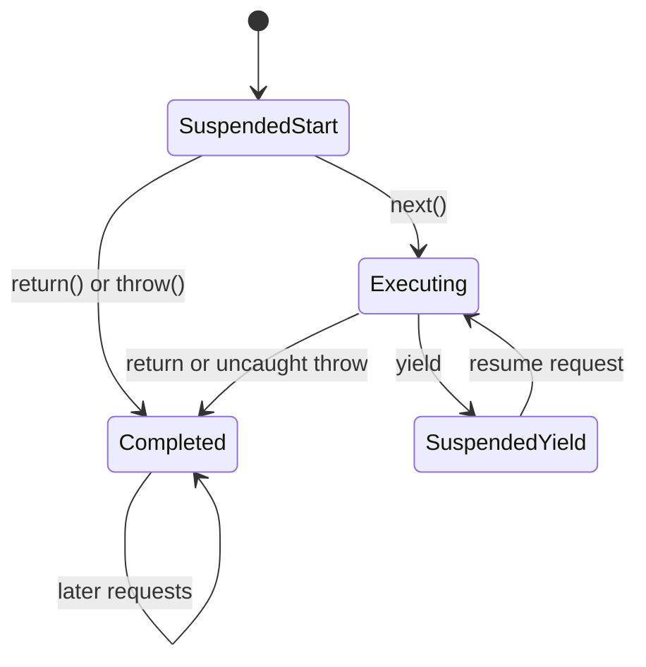

# Async functions, generators, and Promise jobs

This chapter explains how the direct LLVM backend executes suspended
JavaScript computations. The central design is shared with the rest of
Static Hermes: generated LLVM functions implement the program's code, while
the existing virtual machine owns JavaScript objects, environments, exceptions,
garbage collection, and the queue of Promise jobs.

## 1. A suspended computation needs persistent state

An ordinary function enters, executes, and returns. Its temporary native stack
frame can disappear when it returns. A generator can return an intermediate
value and later continue from the next statement. Any variables needed after
that suspension must remain reachable even though the native call has ended.

Consider this generator:

```js
function* counter(start) {
  let value = start;
  yield value;
  value += 1;
  return value;
}
```

The compiler must retain at least the current value and the point at which
execution should resume. Hermes's
[LowerGeneratorFunction pass](../../../lib/Optimizer/Scalar/LowerGeneratorFunction.cpp)
rewrites the generator as a state machine. Its entry switch selects a resume
block. Values that must survive suspension move into a managed environment
associated with the generator. A yield updates the continuation state and
returns an iterator result such as `{value: 10, done: false}`.



The LLVM emitter handles the resulting ordinary control flow and runtime
operations. Its `CreateGeneratorInst` case calls `shllvm_generator`, which
creates a runtime generator object with a managed environment, an LLVM-emitted
resumption function, and function metadata. The bridge is in
[runtime.c](../../../lib/BCGen/SH/LLVMNative/runtime.c); the emission case is in
[LLVMBackend.cpp](../../../lib/BCGen/SH/LLVMNative/LLVMBackend.cpp).

### Why exceptions also need state

Resumption can enter a block that originally appeared inside a `try`. A normal
native call stack cannot preserve the old try activation across suspension.
The shared generator-lowering pass therefore records which JavaScript handler
applies and uses a central exception dispatcher. This preserves the source
relationship between a suspended expression and its catch/finally clauses.
The pass's introductory comments describe this transformation directly.

## 2. An async function uses a generator as its continuation

Hermes lowers an async function to a generator driven by a runtime helper.
This is the conceptual transformation documented in
[02-AsyncFn.js](../../../lib/InternalJavaScript/02-AsyncFn.js):

```js
async function increment(value) {
  return (await value) + 1;
}
```

```js
function increment(value) {
  return spawnAsync(function* () {
    return (yield value) + 1;
  }, this, arguments);
}
```

These snippets explain the execution model; the compiler also supplies the
environments and bookkeeping needed for lexical bindings and arguments.

`spawnAsync` creates the async function's result Promise and starts the
generator immediately. It runs until the first await boundary or until it
finishes. At a boundary, the driver normalizes the yielded operand to a
Promise and attaches continuations. Fulfillment resumes the generator with
`next(value)`. Rejection resumes it with `throw(reason)`, allowing the original
source catch block to handle the failure. A final return resolves the result
Promise; an uncaught exception rejects it.

The helper reuses one internal reaction record across successive awaits of
one invocation. It attaches that record through the Promise implementation's
internal operation. This avoids accidentally invoking a user override of
public `.then` while performing an internal await operation.

An await does not require a new operating-system thread. Execution returns to
the host, and a later Promise job resumes the managed continuation. The CLI
entry point `shllvm_run` executes the compiled unit and then enters
`run_event_loop`. The console event loop drains microtasks before timer work
and after each timer callback. The implementation is in
[ConsoleBindings.cpp](../../../tools/shermes/ConsoleBindings.cpp).

## 3. Promise order is observable program behavior

The order of callbacks matters even when every process exits successfully.
For example:

```js
Promise.all([Promise.resolve(1)]).then(() => print("all"));
Promise.resolve().then(() => print("tick"));
```

The reference output is `tick` followed by `all`. The original shared runtime
produced the opposite order because it synchronously resolved the element of
`Promise.all` when the input Promise was already fulfilled. The corrected
implementation always invokes the input's `then` method and lets its reaction
run as a job. The reproduced failure and regression are recorded in
[the development diary](async-validation-diary.md) and
[promise_order.js](../../../test/LLVMNativeExtensions/promise_order.js).

A thenable has a callable `then` property. Resolving it has two separate
observable actions: obtain the property, then invoke the function in a later
job. The implementation now preserves that separation. It uses a captured
`Reflect.apply` intrinsic when invoking the function, so arbitrary properties
named `call` or `bind` on that function cannot alter the internal operation.
See [promise_thenable_jobs.js](../../../test/LLVMNativeExtensions/promise_thenable_jobs.js).

Promise identity also matters. Public `Promise.resolve` preserves the identity
of an appropriate existing Promise, but it must create a fresh wrapper for
ordinary values. The previous implementation returned shared cached Promises
for several primitive values. Those caches are now restricted to internal
await machinery and are not returned by public resolve.

### Subclasses and capabilities

A Promise capability is a record containing a result object and its resolve
and reject functions. Promise methods select the constructor for a derived
result through `Symbol.species`, create its capability, and settle it when
the reaction runs.

The corrected subclass path settles the chosen capability in the same
reaction job. An intermediate Promise would add another observable scheduling
step. `finally` also uses the abstract PromiseResolve operation for its
callback result; it does not consult an overridable static `C.resolve`
property. The source is
[01-Promise.js](../../../lib/InternalJavaScript/01-Promise.js), with focused
coverage in [promise_species.js](../../../test/LLVMNativeExtensions/promise_species.js)
and [promise_subclass_order.js](../../../test/LLVMNativeExtensions/promise_subclass_order.js).

## 4. Async generators have two kinds of suspension

An async generator combines the generator protocol with Promise-returning
iterator methods. Each external `next`, `throw`, or `return` request creates a
Promise and enters a request queue. The runtime processes requests in order.

Inside the transformed generator, suspension can mean either:

- an internal await whose result should be sent back into the generator; or
- a source yield whose value should be delivered to the current consumer.

The AST transformation marks internal awaits with an `OverloadYield` wrapper.
The driver in [04-AsyncIterator.js](../../../lib/InternalJavaScript/04-AsyncIterator.js)
uses this marker to distinguish the two cases. Delegated `yield*` has a
separate marker and an adapter that connects async iteration to the lowered
synchronous generator protocol.

### Return must be handled at the correct source location

Two superficially similar operations need distinct handling:

```js
async function* example() {
  try {
    yield "ready";
    return somePromise;
  } catch (error) {
    yield "recovered";
  } finally {
    await cleanup();
  }
}
```

A source `return somePromise` must await its expression while the source
try/catch/finally context is still active. The AST transformation makes this
await explicit. If the Promise rejects, the catch can run before completion.

An external `iterator.return(value)` must first await its argument and then
inject the appropriate return or throw completion at the suspended yield.
For example, a rejected return argument may be caught by the source catch
above. The driver handles this normalization at request entry.

If either operation reaches an await in `finally`, successful fulfillment
resumes that internal await with `next`. The underlying generator already
holds the pending completion. Injecting another `return` would discard the
remaining cleanup and could replace the original return value.

After the generator completes, its final result is already prepared. The
driver completes the request without adding another await. It drains queued
completed next/throw requests iteratively; this prevents a long completed
queue from recursively consuming the native stack. A queued return request
still awaits its argument before completion.

The return protocol is tested by
[async_generator_return_values.js](../../../test/LLVMNativeExtensions/async_generator_return_values.js),
[async_generator_return_order.js](../../../test/LLVMNativeExtensions/async_generator_return_order.js),
and [async_generator_queue_completion.js](../../../test/LLVMNativeExtensions/async_generator_queue_completion.js).

The frontend must also traverse the complete source expression before adding
these wrappers. It visits the operand root of each await and yield, which
preserves nested awaits and transforms async generators appearing directly
inside either operand. It visits function parameter defaults before moving
parameters into a transformed function. Each nested function establishes its
own context, and parameter traversal starts outside the enclosing generator's
context; otherwise a return or await could be rewritten as part of the wrong
computation. The regressions are
[async_nested_expressions.js](../../../test/LLVMNativeExtensions/async_nested_expressions.js)
and [async_parameter_expressions.js](../../../test/LLVMNativeExtensions/async_parameter_expressions.js).

## 5. Garbage collection and validation

While a computation is suspended, the generator environment and the Promise
continuations keep its captured values reachable. During native execution,
the LLVM backend's registered root slots let the VM find live JavaScript
values. Code in the VM follows the repository's
[GC-safe coding rules](../../../doc/GCSafeCoding.md).

The additional native `HermesInternal.isConstructor` helper is a small
predicate used for species validation. It reuses the VM's constructor test
without invoking JavaScript or inspecting user properties. Its argument is
already rooted in the native call frame; the wrapper performs no allocation.

The integration suite uses two complementary references. Matching the C
backend checks that the new LLVM path agrees with the inherited implementation.
Matching Node checks behavior independently of that shared runtime. The
Promise ordering and async-generator cleanup defects illustrate why both
comparisons are useful: C and LLVM can agree on the same incorrect result.

The harness runs frontend O0/O and native LLVM O0/O2, then executes each
executable fixture through the real `lli` JIT. Async fixtures require explicit
completion lines. Expected errors, compiler rejections, and deliberately
unsupported runtime boundaries are separate contracts; they are not counted
as successful semantic execution. The harness and metadata format are
documented in [the test README](../../../test/LLVMNativeExtensions/README.md).

## Further reading

- [ECMAScript: NewPromiseReactionJob](https://tc39.es/ecma262/multipage/control-abstraction-objects.html#sec-newpromisereactionjob).
- [ECMAScript: NewPromiseResolveThenableJob](https://tc39.es/ecma262/multipage/control-abstraction-objects.html#sec-newpromiseresolvethenablejob).
- [ECMAScript: SpeciesConstructor](https://tc39.es/ecma262/multipage/abstract-operations.html#sec-speciesconstructor).
- [ECMAScript: AsyncGeneratorUnwrapYieldResumption](https://tc39.es/ecma262/multipage/control-abstraction-objects.html#sec-asyncgeneratorunwrapyieldresumption).

## Questions for review

1. Which values in `counter` must survive its first yield, and why can a
   returned native stack frame not be their persistent storage?
2. Why can an already-fulfilled Promise still require a queued reaction?
3. What goes wrong if an async generator waits for a rejected return value
   only after its source catch/finally regions have finished?
4. Why does agreement between C and LLVM alone not establish JavaScript
   semantic correctness?
