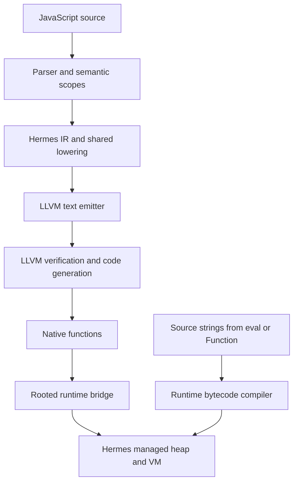
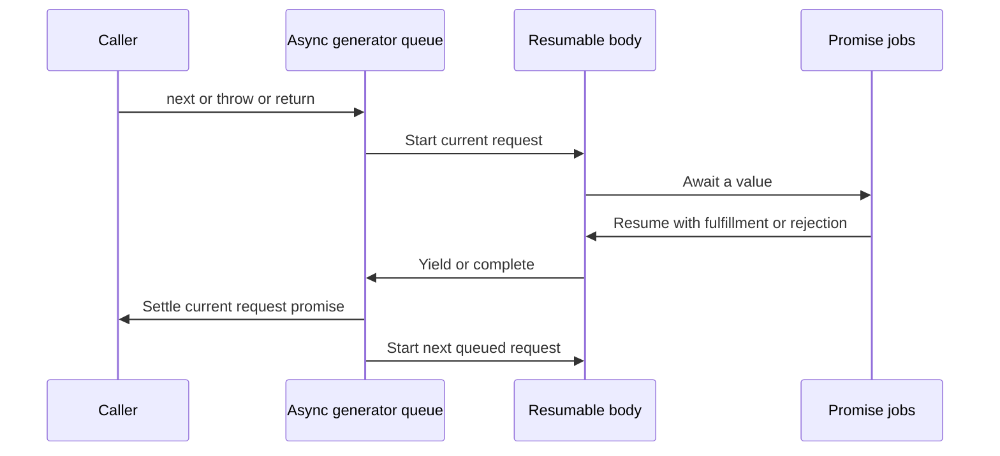
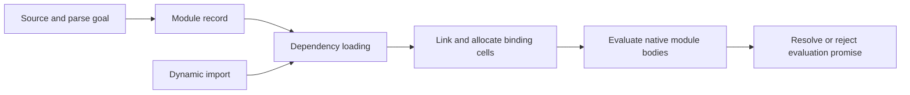

# Direct LLVM JavaScript: an intern's guide to architecture and ECMAScript conformance

## 1. Purpose, scope, and evidence

This project compiles JavaScript functions to native machine code through LLVM while retaining Hermes as the managed runtime. The runtime implements objects, strings, lexical environments, garbage collection, and many operations whose behavior depends on JavaScript types. A second compilation route handles source strings supplied at runtime: Hermes compiles these strings to bytecode, which executes against the same managed objects and environments. Understanding the interaction between these routes is essential before changing language behavior.

The immediate engineering objective is to turn a validated compiler prototype into an implementation with a defensible ECMAScript conformance claim. That requires more than adding missing LLVM instructions. Parsing, name resolution, optimization, object internal methods, exception timing, module loading, job scheduling, and the test host all contribute observable behavior. A correct native instruction sequence can still execute incorrect language semantics supplied by a shared runtime component.

This guide explains the delivered implementation first and then proposes a staged conformance program. Proposed APIs, data structures, commands, and acceptance gates are explicitly identified. This ticket delivers documentation and research; it does not implement that program. The source baseline is commit `3c3d5d6c803ae3711ec5d2d128237acf5dc38997`, imported from the verified extensions archive. Source references below are relative to the repository root. Symbol names are the durable navigation anchors; line numbers refer to this baseline.

The earlier local validation completed 22 core source contracts and 53 extension source contracts, with driver and defaults checks also passing. These figures include expected errors and deliberate unsupported-context rejections. They establish regression coverage, not whole-language support. The machine-readable records are in `ttmp/2026-10-28/extensions-validation/`; `EXTENSIONS-IMPORT.md` explains provenance and local toolchain differences. No full Test262 run was performed for this guide.

Use ECMAScript 2026 as the proposed edition baseline, and pin a Test262 commit when implementing the runner. The edition-specific specification URL was consulted on 2026-10-28. Its rendered front page labels its snapshot as a draft dated March 31, 2026; record that artifact identity rather than assuming a live URL is an immutable publication. Maintain a separate exploratory lane for later proposals and suite changes.

## 2. Essential concepts through one program

Consider a function that returns a closure:

```javascript
function counter() {
  let n = 0;
  return function increment() {
    n += 1;
    return n;
  };
}
const next = counter();
print(next(), next());
```

The expected printed values are `1 2`; this example is explanatory, not a newly recorded execution. A closure is a function together with access to the environment in which it was created. An environment contains bindings: associations between source names and storage locations. Because `increment` can outlive the call to `counter`, the storage for `n` must remain accessible after that call returns. In this backend, managed environment storage supplies that lifetime.

The frontend parses source into an abstract syntax tree, or AST, whose nodes describe source constructs. Semantic analysis establishes declarations and references. IR generation produces Hermes intermediate representation, a form with explicit operations and control-flow blocks. Lowering replaces higher-level operations with forms the backend admits. Optimization changes this representation while preserving observable behavior. The LLVM emitter writes LLVM IR, after which LLVM verifies, optimizes, and generates machine code.



A tagged value is the runtime representation of a JavaScript value together with enough information to distinguish its kind. The generated ABI transports an eight-byte `SHLegacyValue` in an LLVM `i64`; that LLVM type does not imply JavaScript integer arithmetic. A garbage-collector root is a location the collector knows to examine when tracing reachable objects. A safepoint is a point at which execution may permit collection. Any helper that allocates or calls user code must be treated with care because values may need to remain reachable across that call.

An abrupt completion describes control transfer such as throwing an exception or returning from a function. The implementation does not literally allocate a specification Completion Record for every operation. It must nevertheless preserve the corresponding effects, including cleanup and the point at which an error becomes observable. This distinction becomes important when comparing compiler diagnostics with runtime exceptions.

## 3. Repository orientation and source-reading order

Start with `hermes/utils/shllvm.py`, which coordinates emission and execution. Then read `hermes/lib/BCGen/SH/SH.cpp`, specifically `sh::lowerForLLVM` near line 3273. The backend proper is under `hermes/lib/BCGen/SH/LLVMNative/`, not a top-level `BCGen/LLVMNative` directory. Read `LLVMBackend.cpp` alongside `runtime.h`: each emitted call becomes easier to understand when its ABI declaration is visible.

The following sequence keeps dependencies explicit:

1. Read `README.md` and `EXTENSIONS-IMPORT.md` to establish release identity and build assumptions.
2. Read `hermes/docs/llvm/ARCHITECTURE.md` and `DRIVER.md` for the compilation pipeline.
3. Trace `FunctionEmitter::generate`, the instruction dispatch, and the runtime frame helpers.
4. Follow one environment load and store into `runtime.c` before reading lexical eval.
5. Read `LowerGeneratorFunction.cpp` before the async implementation files.
6. Read the extension fixtures and their harness before interpreting aggregate validation totals.
7. Read the inherited Test262 runner last, comparing its assumptions with the proposed LLVM runner.

The `picocalc-llvm-poc/` subtree is a separate embedded proof of concept. Its existence does not make the host64 Hermes runtime a working RV32 runtime. A portable language implementation and a physical PicoCalc deployment require separate evidence. Keep host conformance progress independent from device feasibility until pointer layout, runtime memory requirements, toolchain support, and host services have been measured for that target.

## 4. The compiler driver and compilation boundaries

`shllvm.py` provides `emit`, `run`, and `jit` workflows. Native execution and `lli` exercise different loading paths, so both remain useful. Native programs link the bridge and runtime into an executable; `lli` uses the runtime through the JIT execution arrangement. Neither workflow makes dynamically evaluated strings compile through LLVM.

Useful commands, from `hermes/`, are:

```bash
cmake --build build-llvm \
  --target shermes shllvm_runtime shllvm_runtime_shared --parallel 4
python3 utils/shllvm.py emit \
  test/LLVMNativeExtensions/generator_protocol.js -o /tmp/generator.ll
python3 utils/shllvm.py run \
  test/LLVMNativeExtensions/generator_protocol.js
python3 utils/shllvm.py jit \
  test/LLVMNativeExtensions/generator_protocol.js
python3 utils/shllvm.py run --hermes-arg=-Xasync-generators \
  test/LLVMNativeExtensions/async_generators.js
```

These are reproduction instructions, not additional executions made during this documentation task. The driver can consult `LLVM_BIN` and `HERMES_BUILD_DIR`; specify paths explicitly in automated validation so an unrecorded shell configuration cannot silently select another compiler. Record compiler and runtime flags, not just executable versions.

The shared lowering pipeline stops before transformations specific to the C backend's register and call conventions. An LLVM backend extension must therefore be designed against the IR that actually reaches this boundary. A list of all Hermes instruction classes is not a list of missing JavaScript features: some instructions never survive lowering, and several instructions represent specialized internal typed forms rather than ordinary ECMAScript source.

The emitter ends its dispatch with an explicit unsupported-instruction diagnostic around line 946. That diagnostic is useful evidence. It must not be reclassified as an expected language error just to increase a test pass count. A future inventory should record source fixture, frontend flags, lowered instruction, and failure category, then identify whether to add lowering or implement the instruction directly.

## 5. Values, roots, frames, and calls

The bridge's fundamental contract appears at the beginning of `runtime.h`: value pointers address rooted eight-byte slots, and helper interfaces avoid aggregate arguments and returns. Native JavaScript callbacks retain the existing host64 Hermes ABI. `shllvm_enter` links the generated activation into runtime frame state; `shllvm_roots` exposes its root storage; `shllvm_leave` removes the activation on normal completion.

```c
/* Existing declarations, abbreviated only by selecting relevant APIs. */
void *shllvm_enter(void *shr, void *storage, uint32_t root_count,
                   uint32_t max_args, uint32_t unit_index);
void *shllvm_roots(void *storage);
void shllvm_leave(void *shr, void *storage, void *frame);
void shllvm_env_load(void *out, void *env, uint32_t index);
void shllvm_env_store(void *shr, void *env, void *value, uint32_t index);
void shllvm_call(void *out, void *shr, void *frame, void *callee,
                 void *this_value, void *new_target,
                 uint32_t argc, void *argv);
```

`argc` excludes the receiver; `argv` contains contiguous tagged values. The explicit receiver and `new.target` are semantically significant. Ordinary calls, method calls, constructors, and lexical arrows do not all derive these values in the same way. A correct call helper must also preserve the lifetime of the callee and arguments while a getter, proxy, or coercion invokes more JavaScript.

The emitter allocates separate slots for values with users and shares a discard slot for unused results. Sharing result storage does not authorize removing an operation with side effects. Calling a function whose result is unused can still mutate objects, throw, enqueue work, or trigger collection. The discard slot is per activation, so nested calls have separate storage.

```text
Conceptual generated activation
+----------------------------------+
| Runtime frame and root metadata  |
+----------------------------------+
| Root slots for live IR values    |
| Scratch and discard storage     |
+----------------------------------+
| Argument vector                 |
+----------------------------------+
| LLVM spills and native overhead |
+----------------------------------+
```

`FunctionEmitter::generate` rejects functions for which `slots_.size() + 2 + max(1, maxArgs_) > 1024`. This bounds explicit tagged root/argument payload to about 8 KiB. It does not bound the entire stack frame or recursive stack use. The check exists because a sufficiently large stack allocation could exceed the runtime's stack-check safety assumptions.

A future resource-management change must preserve stack safety and collector visibility together. Candidate designs include liveness-based root reuse and managed spill storage, but neither is implemented by this ticket. Liveness must include exception edges, closure captures, eval-visible bindings, and suspended state. Validate reuse with collection forced between helper calls; an ordinary output comparison may never trigger the relevant lifetime bug.

## 6. Control flow, exceptions, and optimizer obligations

A basic block contains straight-line operations followed by a transfer of control. A phi operation chooses a value according to the incoming predecessor. The emitter implements edge transfers through rooted slots. When several phi assignments occur on an edge, their sources must be read before destinations are overwritten. Otherwise swapping two values through a loop back-edge can corrupt the second assignment.

```text
Proposed review pseudocode for parallel phi transfer:
    pending = []
    for each phi in successor:
        pending.append(load(phi.source_for(predecessor)))
    for each phi and saved_value in matching order:
        store(phi.destination, saved_value)
    branch successor
```

The existing exception mechanism uses `_setjmp` in generated code with the required returns-twice semantics. The saved context must remain inside a live activation. Saving it inside a helper that returns before a later throw would make the eventual non-local transfer invalid. Roots and try-state handling must remain valid across the exceptional return path. `shllvm_catch_prepare` restores the runtime frame state before the handler continues.

C++ runtime work introduces a second constraint: non-local exception transfer must not bypass live C++ objects whose destructors own resources. The eval implementation uses a `CallResult`-returning helper so ordinary C++ cleanup finishes before the exported bridge performs the runtime throw. Preserve that boundary when adding module or realm helpers.

Optimizations must model indirect effects. Direct eval can read a binding that has no ordinary source-level read and write a binding that appears locally constant. Existing changes in frame load/store analysis, scope hoisting, stack promotion, function analysis, and type inference preserve eval-visible state. In particular, preserving the empty or uninitialized sentinel is necessary for temporal-dead-zone checks. A type union that collapses to an ordinary value type too early can incorrectly remove a required error.

## 7. Generators and asynchronous execution

A generator preserves enough execution state to resume after yielding. Hermes's `hermes/lib/Optimizer/Scalar/LowerGeneratorFunction.cpp` transforms generator control flow into resumable functions and environment state. The LLVM backend supplies the remaining generator construction and iterator operations through `shllvm_generator`, `shllvm_iterator_begin`, `shllvm_iterator_next`, and `shllvm_iterator_close`. This implementation uses the existing Hermes transformation rather than LLVM coroutine intrinsics.

The retained state includes local bindings and control information needed by `finally` and delegated iteration. Calling `return` on a suspended generator can enter cleanup that itself yields. Consequently, a generator's externally requested completion and its immediate suspended operation are distinct pieces of state. Tests must cover normal exhaustion, injected exceptions, early return, iterator closing, and collection while the generator remains suspended.

Async functions are transformed into generator-driven execution. `hermes/lib/InternalJavaScript/02-AsyncFn.js` resumes with `next` after fulfillment and `throw` after rejection. Promise reactions arrange the resumption. `01-Promise.js` therefore affects both direct Promise users and async functions. Observable behavior includes when a thenable's `then` getter runs, when the returned method is invoked, which constructor creates a derived Promise, and how many jobs occur before a reaction executes.

Async generators add a request queue, implemented in `04-AsyncIterator.js`. `startRequest` near line 171 processes queued operations. Internal awaits in cleanup must resume the suspended computation correctly even when the external request was a return. Return expressions are awaited in their original exception-handling region so rejection reaches the correct source handler. AST transformation in `hermes/lib/AST/AsyncGenerator.cpp` must also traverse nested operands and parameter defaults under the right function context.



`hermes/lib/VM/StaticHInit.cpp` and console event-loop code connect jobs to the host. A test process exiting with code zero is insufficient evidence for an async test: it may have exited before its completion callback ran. The existing inherited runner already checks the asynchronous completion marker in `utils/testsuite/hermes.py` near line 142. Preserve this behavior when adding a native LLVM execution mode.

## 8. Rich values and object internal behavior

RegExp literals, BigInt literals, private state, and typed arrays use runtime semantics rather than ad hoc native substitutes. `value_extensions.c` and its header connect literal and private operations to the VM. BigInt literals are serialized as exact integer bytes; passing them through a floating-point Number would lose information before runtime arithmetic begins. Literal RegExp evaluation must create the appropriate fresh object, even if the pattern text is shared in unit metadata.

A private name is not an ordinary string property key. Private access and private membership involve receiver branding. This distinction affects errors, inheritance, and proxy behavior. Do not replace private operations with named property lookup as a shortcut to increasing syntactic coverage.

Typed arrays are exotic objects: some internal property operations differ from ordinary objects. The release changes `hermes/lib/VM/JSObject.cpp` to recognize canonical numeric index strings before ordinary-property fallback. Property operations can also receive a distinct receiver. The target determines the initial algorithm, but a later definition may apply to the receiver. Values such as the string `"-0"`, `"NaN"`, or an out-of-bounds canonical index therefore need separate cases from an ordinary named property.

The release includes a specification-directed receiver probe whose expected behavior differs from the tested Node version. This is an example of why differential testing is a diagnostic aid rather than the final authority. Preserve the minimal source, the exact runtime versions, and the algorithm reference whenever engine outputs disagree. Do not change an expected result solely because one oracle differs.

For future builtin work, test property descriptors, getter side effects, iterator closing, subclass construction, realm selection, and exceptional coercions. A constructor existing on the global object is only the beginning of its observable contract. These tests often find defects in shared VM code rather than in LLVM emission.

## 9. Lexical eval and shared environments

Direct eval evaluates source in a caller-dependent context. The delivered bridge supports strict-caller direct string eval and shares native environment cells with dynamically compiled closures. Indirect eval and `Function` construction use global dynamic compilation semantics. Non-string eval arguments pass through unchanged.

The existing interface is declared in `eval_extensions.h`:

```c
typedef struct SHLLVMEvalBinding {
  const char *name;
  uint32_t slot;
  uint32_t flags;
} SHLLVMEvalBinding;

typedef struct SHLLVMEvalScope {
  const SHLLVMEvalBinding *bindings;
  uint32_t binding_count;
  uint32_t slot_count;
} SHLLVMEvalScope;
```

The flags encode TDZ, const, and silent-const behavior. Descriptors contain no GC pointers. Scope order runs from outermost to innermost, while each binding records its physical environment slot. This is important because optimization can merge or rearrange physical scopes without changing source visibility. The compiler must preserve lexical shadowing rather than exposing every physical slot as a visible declaration.

`FunctionEmitter::emitEval`, near line 481, emits these descriptors and passes the current environment, receiver, and `new.target` to `shllvm_eval_direct`. The C++ helper builds a non-executed compiler scope scaffold, remaps visible declarations to existing environment slots, and compiles the string to bytecode. Native and bytecode closures then read and write the same managed storage. Copying values into a separate object would not preserve this aliasing.

The release explicitly rejects sloppy-caller direct string eval, dynamic enclosing private/super context, and direct eval in derived constructors or their captured arrow contexts. Those are implementation boundaries. The specification's `PerformEval` distinguishes caller context, lexical and variable environments, private environments, and strictness; a strict directive inside the evaluated source does not make the release's current sloppy-caller restriction disappear. See [ECMAScript 2026 PerformEval](https://tc39.es/ecma262/2026/multipage/global-object.html#sec-performeval).

A conformance implementation needs a richer context contract. The following is proposed design notation, not an existing API:

```text
EvalContext {
    realm
    lexical_environment
    variable_environment
    private_environment
    this_binding_state
    new_target
    home_object
    source_context_flags
}

perform_dynamic_eval(source, context):
    if source is not a string: return source
    validate syntax against source_context_flags
    instantiate declarations in the appropriate environments
    compile with binding locations and context metadata
    execute against those same managed environments
    return normal or abrupt completion
```

Sloppy eval can introduce bindings whose names were not known during native compilation. A proposal is to add dynamic binding storage to eval-capable variable environments and make potentially affected name resolution consult it. The storage must represent binding attributes and lexical conflicts; a plain property bag is insufficient. Another option is a more general environment-record representation for all affected scopes. Evaluate memory cost and optimization effects with concrete fixtures before choosing. Removing the strict-caller guard alone would produce incorrect semantics.

Derived constructors require special attention because `this` can be uninitialized before `super`. An eval context must preserve that state instead of eagerly reading a normal receiver value. Private and super references require identity-bearing metadata, not just source names. Escaping eval-created closures must retain every required context object across collection and nested evaluation.

## 10. What the current evidence establishes

The local extension validation used four native optimization combinations: frontend O0/O and LLVM O0/O2. Its 53 contracts comprise 44 positive programs, three expected language errors, three runtime boundary rejections, and three compiler rejections. The 50 executable cases also ran through `lli`. The core suite has its own 22 source contracts. These counts are recorded evidence from the prior validation step, not newly inferred totals.

The C backend is a useful comparison because it shares frontend lowering and the runtime. That sharing also limits independence. A shared Promise bug may affect C and LLVM identically. Lexical-eval cases where the C helper lacks caller-environment semantics are recorded separately. Node supplies another comparison, but tests must execute as scripts rather than accidentally inheriting CommonJS wrapper semantics.

The imported archive reports an ASan build. The fresh local build used for the earlier validation was not that ASan build. Generated LLVM bodies were not claimed to have comprehensive ASan instrumentation even in the archived report. Keep build-specific claims attached to the matching evidence record.

The current task adds source inspection and specification research. It does not establish new pass rates, a complete failure inventory, or physical device behavior. In particular, a skip-list entry is evidence of inherited test policy; it is not proof that every test tagged with that feature fails in the updated release.

## 11. Defining the conformance target

A conformance target must name an edition, a host profile, supported targets, and optional behavior. ECMA-262 requires the specified syntax and semantics, distinguishes normative optional clauses from required legacy clauses, and constrains extensions. Internationalization APIs bring ECMA-402 obligations. A narrow deployment milestone can be useful, but unresolved required behavior must remain visible when describing progress toward full compatibility. See [ECMAScript 2026 conformance](https://tc39.es/ecma262/2026/multipage/conformance.html).

Proposed target configuration:

```yaml
# Proposed configuration; not consumed by current tools.
profile: ecmascript-2026-host64
specification: edition-specific artifact plus recorded digest
test262_revision: REQUIRED_BEFORE_BASELINE
execution_paths: [native-llvm]
comparison_paths: [hermes-bytecode, native-c, independent-engine]
host: command-line-script-and-module
optional_behavior: explicit clause-level manifest
internationalization: separately measured ECMA-402 profile
experimental_proposals: separate informational results
```

The profile must not silently omit modules, sloppy semantics, or cross-realm behavior merely because existing tests skip them. Host APIs such as filesystem access and console formatting are separate from the language, but host hooks still have contracts. Specify module loading, Promise job scheduling, string-compilation policy, and realm initialization explicitly. [Annex D lists the host layering points](https://tc39.es/ecma262/2026/multipage/host-layering-points.html).

A resource-constrained PicoCalc profile may intentionally expose less functionality. If so, label it as a restricted profile rather than describing its exclusions as full ECMAScript compatibility. The language conformance plan should first target the existing Linux x86-64 execution environment, where failures can be investigated without simultaneously debugging a new ABI and device host.

## 12. Measured boundaries and investigation priorities

The inherited runner has a particularly important behavior: `hermes/utils/testsuite/test_run_defs.py` near line 170 unconditionally skips tests carrying the `module` flag. Its later skip-list override does not bypass this earlier branch. Therefore, enabling `--test-skiplist` alone cannot establish module coverage.

`skiplist.json` lists dynamic import, resizable ArrayBuffers, several RegExp extensions, tail-call optimization, and other feature categories as unsupported. It separately lists Atomics, SharedArrayBuffer, and cross-realm testing under permanent unsupported features. The release also implements selected Promise species behavior while `Symbol.species` remains in the inherited feature exclusion list. This demonstrates why the list must be re-audited rather than copied into the new project's compatibility policy.

| Area | Evidence status | Required next investigation |
|---|---|---|
| Native generators and async | Targeted positive/error coverage | Run broad language and builtin contracts |
| Strict lexical eval | Implemented with explicit restrictions | Expand context and declaration semantics |
| Sloppy direct eval | Explicit release rejection | Design dynamic binding introduction |
| ESM execution | Runner skips module tests | Inventory parser, module records, loader, and evaluation |
| Runtime error timing | Some frontend early diagnostics documented | Compare negative-test phase and error identity |
| Cross-realm behavior | Inherited permanent exclusion | Audit runtime/realm ownership and host API |
| Shared memory | Inherited permanent exclusion | Evaluate runtime architecture and agent model |
| Recent builtins and RegExp | Inherited feature exclusions | Map each feature to chosen edition and test pin |
| Root-slot limit | Explicit backend admission check | Measure failing valid programs and redesign safely |
| ECMA-402 | Separate tests and platform exclusions | Decide and validate supported Intl surface |
| RV32/PicoCalc | Separate prototype | Establish independent deployment feasibility |

Do not attach numerical implementation estimates to this table before establishing the failure inventory. Module and realm support can require architectural changes, while individual builtin defects may be small. A uniform estimate per feature would hide that difference.

## 13. The first implementation slice: a trustworthy LLVM test runner

The first slice should execute a small, pinned Test262 selection through LLVM and produce complete per-variant records. Reuse the existing metadata parser only after comparing its behavior against the pinned suite's interpretation rules. Add an explicit LLVM mode or a focused runner entry point; avoid changing the meaning of the existing `shermes` mode, which currently represents a different compilation path.

The Test262 contract requires realm isolation, prescribed strict/sloppy variants, special treatment of raw and module tests, harness inclusion, asynchronous completion, and error matching by phase and constructor name. Module fixtures are dependencies rather than standalone tests. The runner must implement the pinned interpretation document, including its host API, rather than infer success from exit status alone. [Test262 interpretation rules](https://raw.githubusercontent.com/tc39/test262/main/INTERPRETING.md).

The proposed result model separates unsupported implementation behavior from expected language errors:

```text
TestVariantResult {
    test_path, source_sha256, suite_commit, variant
    features, includes, parse_goal
    expected: {phase, error_constructor} or normal
    observed: {phase, error_constructor, exit_code, signal}
    status: pass | semantic_failure | unsupported
          | timeout | crash | harness_error | infrastructure_error
    compiler_flags, runtime_flags, optimization_levels
    commands, tool_versions, artifact_hashes
    stdout_path, stderr_path, elapsed_times
}
```

An expected `TypeError` passes only when the corresponding language error occurs at the required phase. An LLVM verifier failure, sanitizer diagnostic, linker error, timeout, or process signal is a different outcome. Compiler rejection of a valid program is unsupported behavior or a defect, even when the release's narrower regression suite intentionally tests that rejection.

```text
Proposed runner control flow:
    load suite lock and selected host profile
    enumerate tests, retaining excluded and fixture inventories
    parse metadata without changing source bytes unnecessarily
    expand the required execution variants
    for each variant:
        create an isolated work directory and runtime instance
        prepare harness and fixture resolution
        invoke compilation with explicit arguments
        if compilation fails:
            distinguish language diagnostic from tool failure
            compare phase and error identity to expectation
        else:
            execute with deadline and bounded captured output
            collect structured language completion and async status
        persist result atomically
    verify input and binary fingerprints are unchanged
    emit totals including unsupported, excluded, and incomplete cases
```

The initial runner's most valuable tests deliberately exercise its own failure classification: an async program that never completes, a wrong error constructor, an expected runtime error rejected at compile time, a simulated signal, a missing fixture, and an output file left from a previous run. These are meaningful tests because a runner that misclassifies them can make all later conformance work appear successful.

Use separate compilation and execution deadlines. Preserve partial results when interrupted, with an explicit incomplete-run flag. Do not publish a complete aggregate until all scheduled variants have terminal records. A low parallelism default is appropriate for native compilation; measure memory pressure before raising it.

## 14. Host API and isolation design

The conformance host should expose the suite's required facilities with real semantics. In particular, realm creation cannot be implemented by returning the same global object, and buffer detachment cannot be implemented as a no-op. Such substitutes invalidate the very tests they are intended to enable.

The following interface is proposed and deliberately independent of a final C++ class layout:

```text
ConformanceHost.createRealm() -> RealmHandle
ConformanceHost.evalScript(realm, source) -> Completion
ConformanceHost.detachArrayBuffer(buffer, key) -> Completion
ConformanceHost.collectGarbage() -> Completion
ConformanceHost.loadModule(referrer, request) -> ModuleHandle
ConformanceHost.reportAsyncCompletion(error_or_success)
ConformanceHost.runJobsUntilQuiescentOrDeadline(deadline)
```

Each handle needs an explicit owner and lifetime. A realm retains its intrinsic objects and global environment. A module retains source identity, dependency records, environment bindings, and evaluation state. Queued jobs retain their callbacks and relevant realm. These references must participate in garbage collection, not merely exist in untracked native pointers.

For the first script subset, a fresh process per test is a useful isolation mechanism. It does not solve `createRealm` within a test: two interacting realms still need correct distinct intrinsics and cross-realm object behavior. Treat this as a runtime design issue and measure it separately from process isolation.

Completion reporting should use a dedicated channel or unambiguous host protocol so ordinary program output cannot accidentally impersonate success. Keep user-visible output intact for debugging. The proposed runner should record duplicate completion, asynchronous failure after earlier success, and uncaught exceptions according to the pinned host contract; it must not stop collecting evidence at the first success-looking line.

## 15. Modules as a language subsystem

ECMAScript modules require distinct parsing, environment creation, import/export binding resolution, graph linking, and evaluation. Cycles and asynchronous evaluation are represented in module records. Host loading supplies requested modules; language algorithms determine linking and evaluation behavior. [ECMAScript 2026 scripts and modules](https://tc39.es/ecma262/2026/multipage/ecmascript-language-scripts-and-modules.html).

For this project, the proposed design is a runtime module registry whose records retain compiled entry points and managed binding cells. Native code loads an imported binding through its target cell so subsequent writes by the exporting module remain observable. A build-time concatenation pass or CommonJS wrapper does not supply this contract.



Implement a two-module live-binding fixture first, then a cycle with an uninitialized binding, then a dependency whose evaluation throws. Only after those work should top-level await be added. For asynchronous graphs, track pending dependencies and propagate rejection without evaluating dependent bodies prematurely. Retain failed evaluation state so repeated imports do not rerun side effects incorrectly.

The host resolver should preserve source identity and resolve relative fixtures against the referring module. Record the policy for supported import attributes and JSON modules. Avoid using the process working directory as an implicit resolver for every import. For conformance tests, a constrained fixture resolver is sufficient initially; a production application loader is a separate host design task.

Proposed entry points are `parseModule`, `linkModule`, and `evaluateModule`, with failures reported at their actual phase. Keep those phases visible in the result model. A single command that reports every failure as “compile failed” cannot distinguish the module behaviors required by negative tests.

## 16. Shared memory, realms, and broader runtime gaps

The inherited permanent exclusions for shared memory and cross-realm tests deserve an architectural review before anyone promises completion dates. A Promise queue in one runtime does not implement concurrent agents. SharedArrayBuffer storage needs lifetime and synchronization rules that can survive access from multiple agents, while ordinary runtime objects may remain confined to their owning runtime or realm.

ECMAScript's memory model constrains shared accesses and distinguishes atomic from unordered operations; racy JavaScript shared-memory programs are not licensed to acquire C++ undefined behavior. A native implementation must preserve the permitted outcomes through compiler optimization and the runtime's access primitives. [ECMAScript 2026 memory model](https://tc39.es/ecma262/2026/multipage/memory-model.html).

A proposed investigation should map runtime thread affinity, shared backing-store ownership, atomic widths, wait/wake facilities, and collector interaction. Test harness agents need real concurrency when the relevant tests require it. A single-thread scheduler that serializes all accesses can conceal races and cannot validate the full memory model.

Additional inventory areas include WeakRef and finalization behavior, resizable/detachable buffers, Unicode and RegExp data, proper tail calls, iterator helpers, resource-management syntax, new builtin methods, and internationalization. This list is a research backlog rather than an assertion that all items are absent. For every feature, determine whether it belongs to the chosen edition, whether the frontend parses it, whether the runtime implements it, whether LLVM admits the lowered IR, and whether the conformance host can exercise it.

Finalization tests need special care because collection timing is not a general deterministic application guarantee. Distinguish a missing operation from a legal nondeterministic outcome. Conversely, a runtime's inability to expose a test hook must not be reported as proof that the associated semantics are correct.

## 17. Design decisions and alternatives

### Decision: retain the managed runtime as the semantic implementation

- **Context:** The LLVM emitter already delegates objects, environments, and many conversions to Hermes.
- **Options considered:** Extend that runtime or implement an independent JavaScript object system beside it.
- **Decision:** Propose extending the existing runtime and its native bridge.
- **Rationale:** Native and dynamically compiled functions need shared object identity and binding storage.
- **Consequences:** Shared frontend/runtime changes require regression coverage beyond the LLVM path.
- **Status:** Proposed continuation of the existing architecture.

### Decision: make test exclusions visible

- **Context:** The inherited runner has both feature exclusions and unconditional module skipping.
- **Options considered:** Reuse exclusions silently or report every selected/excluded variant explicitly.
- **Decision:** Propose explicit exclusion records with reason, clause/profile scope, owner, and review date.
- **Rationale:** Aggregate pass rates are otherwise easy to improve by reducing the denominator.
- **Consequences:** Existing “permanent” exclusions become reviewable project decisions.
- **Status:** Proposed.

### Decision: preserve direct native compilation for admitted static code

- **Context:** Dynamic strings already use bytecode, while the project demonstrates direct LLVM emission for static source.
- **Options considered:** Add automatic bytecode fallback for unsupported static functions, or close native lowering gaps directly.
- **Decision:** Propose direct lowering work first; do not add a hidden fallback in this ticket.
- **Rationale:** A fallback would change deployment characteristics and make native coverage harder to measure.
- **Consequences:** Some valid programs remain explicit failures until implemented. Any future fallback needs an explicit architecture decision and separate coverage accounting.
- **Status:** Proposed; no adapter or fallback has been implemented.

### Decision: establish the host64 baseline before device conformance

- **Context:** The bridge assumes the existing host64 tagged-value ABI, and device execution has different resource constraints.
- **Options considered:** Simultaneous language/target changes or a host-first conformance program.
- **Decision:** Propose host-first measurement with an independent device feasibility track.
- **Rationale:** This keeps failure attribution tractable.
- **Consequences:** Host progress does not imply PicoCalc readiness.
- **Status:** Proposed.

## 18. Implementation phases with reviewable outputs

### Phase 1: inventory and runner foundation

Pin the specification artifact, Test262 revision, compiler/runtime commit, and build configuration. Add the explicit LLVM test mode and a small set of runner self-tests. Produce a machine-readable manifest covering every enumerated test and variant, including unsupported and excluded cases. Acceptance requires correct classification of deliberately wrong error phase, missing async completion, crashes, and missing fixtures. A mentor should review the result schema before a large run.

### Phase 2: establish the unoptimized semantic baseline

Run the admitted script subset with frontend O0 and LLVM O0. Preserve every failure and reduce representative cases. Compare with the bytecode and C routes to identify shared defects, then consult independent engines and specification algorithms where outputs disagree. Acceptance is a reproducible baseline with categorized failures, not an arbitrary pass-percentage target.

### Phase 3: correct frontend and eval semantics

Audit static diagnostics against runtime error expectations, retain TDZ and const checks at the required execution point, and implement richer eval context and binding behavior in small increments. Start with sloppy eval adding a variable visible to a later native read, then lexical conflicts, nested eval, escaping closures, and derived-constructor context. Acceptance requires relevant Test262 groups plus focused GC and optimization regressions.

### Phase 4: implement module and realm foundations

Add module record ownership, live binding cells, linking, evaluation state, and the fixture resolver. Add realm creation and cross-realm tests with explicit ownership. Sequence top-level await after synchronous cycles and error propagation. Acceptance includes repeated imports, cycle errors, namespace behavior, isolated intrinsic mutations, and retained module/realm state across GC.

### Phase 5: close runtime and builtin families

Use the measured backlog to assign bounded feature groups: RegExp behavior, buffers, object internal methods, Promise and iterator algorithms, Unicode-sensitive behavior, and selected edition additions. Each change includes a minimal regression, the relevant Test262 group, and explicit source/algorithm references. Remove an exclusion only when its coverage has actually been rerun under the target configuration.

### Phase 6: shared-memory and resource architecture

Implement the reviewed agent/backing-store design if required by the selected full target. Address valid-program failures caused by frame admission through a root-storage design that preserves GC and exception invariants. Acceptance includes concurrent tests, stress tests, sanitizer checks where supported, and bounded stack/heap measurements. These tasks warrant senior review rather than an isolated intern patch.

### Phase 7: optimize and qualify the release

Expand the full frontend/LLVM optimization matrix, compare native and `lli` results where meaningful, and run complete selected inventories without hidden filters. Freeze fingerprints, publish raw results and profile exclusions, and investigate every remaining required failure. A release claim must name target, edition artifact, host policy, suite commit, and remaining limitations. Passing Test262 is strong evidence but not a proof of all ECMAScript behavior; the suite itself documents incomplete coverage. [Test262 project goals and state](https://github.com/tc39/test262).

## 19. A practical first assignment for an intern

Begin with runner classification, not a broad language feature. Implement one ordinary script, one strict-only case, one expected parse error, one expected runtime error, and one asynchronous completion case through the proposed LLVM mode. Then deliberately break each case to verify that the runner reports failure for the correct reason. Keep the selected suite commit and generated artifacts in the receipt.

The first review should answer concrete questions: Where are variants expanded? Which process performs compilation? How is the thrown constructor identified? What distinguishes a crash from an expected error? Where is async completion recorded? Can a stale executable be run after compilation fails? Does the result retain the exact source and command? A reader should be able to answer these by following a small number of functions.

For a semantic patch, use this workflow:

1. Preserve the original failing test and its metadata.
2. Write a minimal source example without removing the semantic trigger.
3. Identify the specification operation and the first implementation layer that diverges.
4. Add a focused regression at that layer and an end-to-end native case.
5. Implement the smallest coherent correction, preserving ownership and error behavior.
6. Run the affected family, then the existing core/extension gates when shared paths changed.
7. Record before/after results and remove only the exclusions justified by those results.

A review should reject a patch that merely hides a failure in a larger skip list, catches every exception as success, changes the expected error without specification evidence, or bypasses native execution for a test advertised as LLVM coverage. These checks protect the reliability of the project rather than imposing a particular coding style.

## 20. API and file reference index

All paths below exist in the source baseline. The current APIs are implementation interfaces, not a stable external SDK. Proposed interfaces in earlier chapters must not be mistaken for declarations already available in headers.

| Source | Main symbols or responsibility |
|---|---|
| `hermes/utils/shllvm.py` | Emission, verification, native execution, and JIT driver |
| `hermes/lib/BCGen/SH/SH.cpp` | `sh::lowerForLLVM`, shared lowering boundary |
| `hermes/lib/BCGen/SH/LLVMNative/LLVMBackend.cpp` | `ModuleEmitter`, `FunctionEmitter`, `emitEval`, instruction dispatch |
| `hermes/lib/BCGen/SH/LLVMNative/runtime.h` | Rooted-slot ABI, frame, call, property, iterator, exception declarations |
| `hermes/lib/BCGen/SH/LLVMNative/runtime.c` | Implementations connecting emitted code to Static Hermes |
| `hermes/lib/BCGen/SH/LLVMNative/eval_extensions.h` | Eval binding/scope descriptors and `shllvm_eval_direct` |
| `hermes/lib/BCGen/SH/LLVMNative/eval_extensions.cpp` | Scope scaffold, bytecode evaluation, cleanup boundary |
| `hermes/lib/BCGen/SH/LLVMNative/value_extensions.c` | Runtime support for rich literals and private operations |
| `hermes/lib/Optimizer/Scalar/LowerGeneratorFunction.cpp` | Generator state transformation |
| `hermes/lib/AST/AsyncGenerator.cpp` | Async-generator AST transformation and function-context traversal |
| `hermes/lib/InternalJavaScript/01-Promise.js` | Promise resolution, reactions, combinators, species behavior |
| `hermes/lib/InternalJavaScript/02-AsyncFn.js` | Generator-driven async function execution |
| `hermes/lib/InternalJavaScript/04-AsyncIterator.js` | Async-generator request processing |
| `hermes/lib/VM/JSObject.cpp` | Ordinary/exotic property behavior and typed-array receiver handling |
| `hermes/lib/VM/StaticHInit.cpp` | Static runtime initialization |
| `hermes/utils/test_shllvm_extensions.py` | Release extension contracts and evidence generation |
| `hermes/utils/testsuite/preprocess.py` | `TestCase`, `StrictMode`, metadata and harness preparation |
| `hermes/utils/testsuite/test_run_defs.py` | Test scheduling and unconditional module skip |
| `hermes/utils/testsuite/hermes.py` | Existing compiler/runtime invocation and async result checks |
| `hermes/utils/testsuite/skiplist.json` | Inherited exclusions requiring project-specific review |

For deeper implementation detail, read the two release articles already preserved in `ttmp/2026-10-28/extensions-validation/implementation-report.md` and `engineering-diary-report.md`. They document the delivered extensions and their development history. This guide adds the onboarding sequence, conformance target, runner design, and implementation program.

## 21. Exercises and review questions

1. Trace `n` in the counter example from a lexical declaration to an environment slot. Explain which object retains the slot after the outer call returns.
2. Construct a loop with two values exchanged on a back-edge. Explain why sequential phi stores can produce the wrong result.
3. Add an unused function call to a program. Explain why sharing its result slot cannot justify deleting the call.
4. Describe a valid program that should throw at runtime but could be incorrectly rejected by an eager frontend diagnostic. Explain how a negative-test record distinguishes those outcomes.
5. Draw the ownership chain for an eval-created closure that survives its native caller and a GC cycle. Identify which metadata is immutable and which objects must be traced.
6. Explain why a completed async process is not necessarily a completed async test. Specify the evidence your runner must retain.
7. Design a two-module live-binding fixture and a cyclic TDZ fixture. Identify which failure belongs to linking and which belongs to evaluation.
8. Select one inherited unsupported feature. Determine whether its exclusion is stale, still required, or outside the pinned edition. Document evidence rather than guessing from the feature name.

A successful intern handoff ends with the ability to trace one program across compiler and runtime boundaries, classify one failing contract accurately, and propose a correction with a clear ownership model and a reproducible test. Full conformance remains a measured engineering program whose completion depends on the results of that work.
