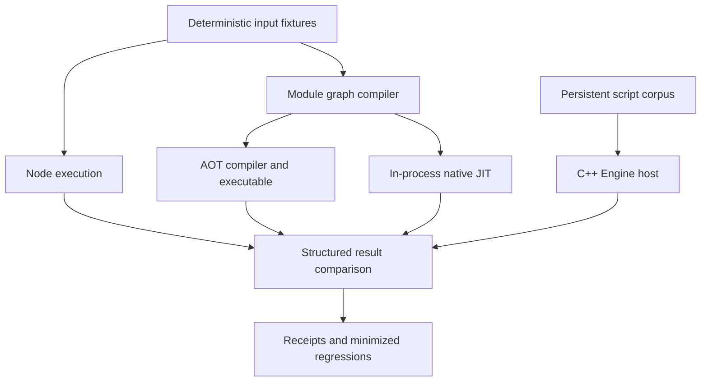

# Four application workloads and qualification

**Implementation checkpoint:** all four applications and the runner are implemented. The final campaign records 96 successful executions and nine explicitly dispositioned fflate O0 admission boundaries. See [the results analysis](../analysis/01-application-qualification-results-and-remaining-boundaries.md). Statements below about proposed commands and incomplete sources describe the original planning checkpoint.

## Objective

Use complete applications to expose practical compiler, runtime, and embedding defects quickly. Implement all four workloads and compare observable results rather than making broad conformance or speculative hardening prerequisites. Fix blockers at their source and preserve small regressions when a real defect is found.

## Workloads

1. Data pipeline: parse a supplied JSON order dataset, validate records and duplicate identities, normalize customer names, aggregate totals and unique customers by region, and print deterministic JSON. Include malformed rows and increase dataset sizes.
2. Async queue: process jobs with bounded concurrency, timers, retries, terminal failures, and cooperative application-level cancellation. Assert cleanup and concurrency invariants; compare sorted final results rather than nondeterministic timer completion order.
3. Persistent host: compile real rule plugins over multiple rounds in one Engine, share a ledger and callbacks, deliberately inject compile and execution failures, force GC, execute later valid work, and report a deterministic final ledger. Compare application state with Node where meaningful; lifecycle assertions belong to the native embedding.
4. Third-party archive application: pin fflate 0.8.2, load its unmodified browser ESM distribution, compress and restore multiple UTF-8 documents, build/extract ZIP, exercise streaming gzip callbacks, and reject malformed input. No package resolver or Worker implementation is required for its synchronous API. Compiling unused library functions is initially left intact to expose backend admission issues.

## Shared input and output contract

A Python runner generates deterministic fixtures and supplies APP_INPUT as a global input object. JavaScript applications remain identical across Node, AOT, and JIT. JSON processing and application algorithms run inside the respective engine. Initial native filesystem APIs are unnecessary: inputs are supplied at startup and JSON output uses print. The persistent workload instead uses a small C++ embedding executable and a replay corpus of separately submitted scripts.

Use Node ESM for the three module applications. Build the same module graphs through compiler.cjs for native execution. The JIT bundle uses --host-completion; the AOT bundle reports an explicit completion marker so an unresolved entry cannot appear successful. Compare outputs with independent Python expectations for data/queue state, and retain Node output as the independent library oracle. Fixed archive timestamps avoid clock-dependent output.

## Execution sequence

Create the applications, run small inputs immediately, and retain the first failures. Build a single qualification command that measures source/bundle compilation and execution separately where practical, includes process peak RSS, repeats workloads, and increases input sizes. Avoid broad test reruns on every edit. Run the affected regression and existing integration gate after a substantive compiler/runtime fix.

Each app has small and larger workloads. The persistent host should exceed the previous eight-unit limit substantially and exercise exceptions after plugin publication. No compatibility shim or source rewrite should conceal a compiler defect. If a host feature is deliberately absent, record the restriction and whether the chosen application actually needs it.

## Acceptance and output

Deliver four runnable applications, pinned third-party dependency and lock, one qualification command, retained measurements/failures, a result report and follow-up list. Successful cases need exact application result checks, not exit status alone. Failure outcomes and admission errors remain distinct from successful outputs. Record code/build identities and distinguish benchmark observations from statistically established performance claims.

The current deliverable is this ticket/design and a vault report about the completed engine/JIT work and the next application qualification phase. Implementation of the complete four-application campaign remains future ticket work. Preliminary sources and the archive probe are retained as exploratory material, not as a completed qualification suite.

## Initial sources

Engine.h and lib/LLVMJIT implement the private persistent API. utils/module-host/compiler.cjs packages static module graphs. utils/shllvm.py supplies the AOT command. The source-distributed fflate library is documented at https://github.com/101arrowz/fflate; only the pinned local dependency contents define this experiment. Existing native/JIT receipts remain historical and are not relabeled as application qualification.

## Initial planning state and evidence boundary

The engine implementation is complete within the scope recorded by LLVM-ENGINE-001 and LLVM-JIT-001. The application campaign is designed, not qualified. Three exploratory application sources exist under `hermes/examples/llvm-apps`; there is no persistent application host or common campaign runner yet. Preserve that distinction when reviewing tasks or interpreting the report.

A small archive experiment compiled the entire pinned fflate browser ESM distribution. Unoptimized Hermes compilation rejected the generated bundle at the existing 1,024 combined root/argument-slot bound. The same input passed under `shllvm-jit -O`: gzip, ZIP, streaming gzip, UTF-8 restoration, and malformed ZIP rejection completed. The input contained two documents totaling 1,430 UTF-8 bytes. The resulting ZIP had 269 bytes and rolling checksum 3522948978. These observations establish one optimized round trip, not full library coverage or a Node/AOT comparison. Raw outputs, input, module check, and selected fingerprints are retained in `reference/evidence/`.

The profile difference is an immediate investigation target. Do not raise the frame cap without checking stack safety, and do not silently remove unoptimized cases from the campaign. Optimization may eliminate values and reduce rooted slots; that explanation must be verified against emitted function counts before proposing an allocator change. The admission failure is separate from the growable runtime unit table already fixed by LLVM-JIT-001.

## Architecture for a new contributor

A compilation unit is a native program fragment initialized once in an existing managed runtime. An application graph is a set of JavaScript modules whose dependencies and evaluation order are established by the module compiler. These are different objects: one graph bundle can become one native unit, and multiple native units can share `globalThis` without sharing an ECMAScript module registry.



For the three module applications, the runner owns input generation, subprocess invocation, timeouts, result parsing, and evidence retention. The JavaScript source owns the actual business or compression algorithm. Native compilation receives module compiler output; Node executes the original module graph. Differences in preparation must be recorded so startup costs are not compared as if they covered identical operations.

The persistent application uses the private `hermes::nativejit::Engine` API. It should not invoke the CLI repeatedly: each CLI process creates a new runtime, which would remove the lifetime behavior the application is intended to exercise. A dedicated C++ executable can submit scripts and inspect `Result` values while preserving one engine across successful and failing submissions.

## Input, result, and failure contracts

The proposed runner interface is:

```text
qualify-apps --app all --size small --repeat 3 --output receipts.json
```

This command is a design proposal; no such executable exists yet. Its receipt should include application, input identity, mode, frontend profile, build identity, exit status, completion state, parsed result, elapsed times, peak RSS, and stderr. A record must distinguish a missing result from an empty result. An execution that exits zero before a module entry fulfills is incomplete.

```text
for each application, size, profile, execution mode:
    prepare the identical logical input
    record source, dependency, and tool identities
    invoke the application with a bounded timeout
    retain stdout, stderr, exit status, and timing
    verify expected completion state
    parse the application's structured result
    compare against its independent contract
    classify: pass, semantic mismatch, compile rejection,
              runtime failure, pending, timeout, harness error
```

Keep unexpected stderr separate from application data. One diagnostic should identify the application and phase without requiring a reader to inspect every command. Cases intentionally injecting errors must assert their expected phases and subsequent recovery rather than counting any failure as success.

## Detailed workload designs

### Data processing

The draft validates order identifiers, rejects duplicate identities, checks nonnegative safe-integer amounts and positive item quantities, normalizes customer identifiers, and accumulates region totals. Use explicit integer amounts in minor units so the reference computation does not require matching floating-point summation order. A Python expectation generator can independently compute accepted/rejected counts, item quantities, totals, and unique customers.

A small fixture should contain one valid record per branch and deliberate malformed records; a medium fixture should contain thousands of records; a larger fixture should exercise sustained allocation with tens of thousands. These sizes are starting proposals, not measured supported capacities. Use stable region and customer normalization rules. If Unicode or locale-sensitive ordering becomes part of the application contract, define it explicitly instead of accepting accidental host locale agreement.

### Asynchronous queue

Each job has an identifier, payload, failure policy, and cancellation point. Workers claim the next index from a shared cursor before awaiting. A concurrency counter increments when a job starts and decrements in `finally`; a peak counter records the maximum. Transient failures retry with a bounded attempt count; permanent failures become terminal outcomes. Cancellation is a cooperative application condition, not engine interruption.

```text
worker:
    while an unclaimed job exists:
        claim job
        if cancelled before start: record cancelled; continue
        active += 1
        try:
            attempt bounded execution with timer-backed retries
            record success, failure, or cancellation
        finally:
            active -= 1
            cleanup_count += 1
```

Compare sorted terminal outcomes, attempt counts, cleanup counts, and the active-count invariant. Do not require a fixed completion order for independent timers. A missing cleanup, duplicate settlement, or active count above the bound is a failure even when payload totals match.

### Persistent embedding application

Create a ledger on `globalThis`, then compile rule plugins that capture private state and publish callable functions. Execute later submissions that invoke earlier functions. Interleave forced collection, asynchronous callbacks, syntax errors, and initializers that publish a closure before throwing. After each intentional error, run a valid submission that checks both retained state and runtime usability.

The native host should use `compile`, `execute`, `drain`, and `collect` explicitly. A failed compile has no executable unit. A failed initializer may already have mutated shared state and must not be retried as if it were transactional. The final ledger should therefore include committed pre-throw effects where the corpus specifies them.

```text
engine = Engine.create()
for submission in corpus:
    compiled = engine.compile(submission.source, submission.filename)
    if compilation failure expected: assert phase; continue
    assert compiled.ok
    executed = engine.execute(compiled.unit)
    assert execution outcome matches corpus
    assert engine.collect().ok
    verify later submissions can use published closures
assert engine.drain() matches expected completion
engine.close()
```

Exceed eight units and then scale into hundreds. Record retained unit counts and peak memory; code retention is expected under the current lifetime policy. Node replay can check ledger semantics, but it cannot validate Hermes root traversal, creator registration, owner-thread enforcement, or native teardown. Those assertions belong to the embedding executable.

### Third-party archive application

Pin fflate 0.8.2 and retain its package integrity in the lock file. Import its browser ESM file by exact relative path. Exercise synchronous gzip/ungzip and ZIP/unzip on multiple named UTF-8 documents, streaming compressor/decompressor callbacks, and malformed input. Include empty documents, non-ASCII text, repeated content, and deterministic low-compressibility bytes when expanding fixtures.

Fixed gzip and ZIP metadata avoid time-dependent output. Compare restored bytes independently of compressed representation, and compare exact compressed output with Node when identical package/options make that comparison meaningful. Compression and decompression from the same library can share a defect, so add a standard-library ZIP/gzip decoder check in the runner where practical. Worker-backed compression remains outside this application because the host does not implement browser workers.

## API and file reading map

| File | Responsibility and review question |
|---|---|
| `hermes/include/hermes/LLVMJIT/Engine.h` | Private API: which operations compile, execute, drain, and release state? |
| `hermes/lib/LLVMJIT/Frontend.cpp` | Request-scoped parsing, resolution, lowering, and IR generation. |
| `hermes/lib/LLVMJIT/Engine.cpp` | LLVM admission, creator lookup, retained code, and owner-thread checks. |
| `hermes/tools/shermes/JITHost.cpp` | Managed runtime, console jobs, GC, and module completion tokens. |
| `hermes/utils/module-host/compiler.cjs` | Build-time graph resolution, transformation, and completion instrumentation. |
| `hermes/lib/BCGen/SH/LLVMNative/LLVMBackend.cpp` | Root-slot allocation and frame admission. |
| `hermes/test/LLVMJIT/engine.cpp` | Existing lifecycle assertions to reuse conceptually in the persistent application. |
| `hermes/utils/test_shllvm_jit.py` | Existing focused validation gate and evidence conventions. |

Read the API and an example result first, then trace `compile` through the frontend and loader. Read runtime teardown before adding host-owned JavaScript values. This API deliberately exposes no raw JavaScript value handle; a future structured-value API would need a separate rooting and lifetime contract.

## Implementation milestones and review gates

1. Finish deterministic inputs and the small data application, then add Node/AOT/JIT comparison with explicit completion. Commit the runnable vertical slice.
2. Add the queue with terminal-state and cleanup assertions. Preserve a minimized regression for each Promise or timer defect encountered.
3. Add the C++ persistent host and error-recovery corpus. Validate state after GC and after throwing initializers, then commit the host milestone.
4. Expand the pinned library probe into reproducible multi-size qualification. Diagnose root-slot pressure and retain both frontend profiles as separate outcomes.
5. Run the complete application matrix, record performance observations and correctness independently, and publish limitations with exact affected scenarios.

After a compiler/runtime correction, run its focused reproducer and the existing relevant integration gate. Documentation changes do not require recompiling the engine. The campaign is complete when all four applications have reproducible commands and receipts, every unexpected failure has been fixed or explicitly dispositioned, and no unexecuted scenario is described as passing.

## Deliberate exclusions

No package ecosystem resolver, browser DOM, Node filesystem compatibility layer, Worker implementation, speculative optimizer, deoptimization engine, or code-unloading system is required to begin these applications. Add a capability only when an application needs it and the cost is justified. Existing module follow-ups remain in LLVM-MODULES-002; this ticket records application evidence and links a discovered module defect there instead of creating a second authoritative backlog.
