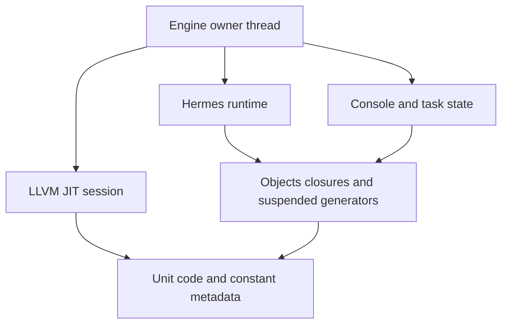

# Practical engine architecture and execution contracts

## 1. Objective and scope decision

Build a useful native JavaScript compiler and an in-process LLVM JIT without turning the project into an attempt to reproduce a complete browser or Node engine. The supported profile must be explicit, tested, and sufficient for representative applications. Full ECMAScript conformance is not an acceptance gate. A known unsupported construct should produce a clear diagnostic; silently changing admitted-program behavior is still a defect.

This document proposes the engine contract. It does not claim that an embedding API or integrated LLVM JIT already exists. The implementation checkpoint inspected is `8db50e0`, with module qualification in `185923d`. The follow-on implementation ticket is LLVM-JIT-001. Deferred module features are inventoried in LLVM-MODULES-002.

A compilation unit is the generated code and constant metadata for one compilation request. An engine owns a Hermes runtime, executable code for its units, and host task state. A JavaScript module graph is a language-level dependency graph; it can be compiled into one unit. These identities must remain distinct. Loading a new unit must not accidentally recreate a second runtime or claim to extend a previously compiled module graph.

## 2. Existing implementation and missing integration

`hermes/utils/shllvm.py` currently emits textual LLVM IR through shermes, verifies it, and either links a native executable or launches an external `lli` process with `libshllvm_runtime.so`. The latter is real LLVM execution but is not an embedding API for a persistent engine.

`hermes::sh::generateLLVM` in `include/hermes/BCGen/SH/LLVM.h` takes Hermes IR, an `llvh::raw_ostream`, and `BytecodeGenerationOptions`. It performs lowering and emits textual opaque-pointer LLVM IR. It is not an API accepting source text. Source parsing, semantic analysis, configuration, and IR generation currently sit in the shermes command implementation, including `compileFromCommandLineOptions()`.

The emitted unit has a creator named `sh_export_<unitName>`. `BytecodeGenerationOptions.emitMain` controls whether a standalone main is emitted. The emitter's `@shllvm_unit_index` is internal mutable storage, and the generated functions use it to locate runtime unit state. These existing entry points let the first JIT reuse the backend rather than design a new calling convention.

`shllvm_run` combines runtime creation, console binding initialization, unit initialization, task draining, and destruction. A persistent engine must separate that lifecycle from one-shot command execution. Calling generated main repeatedly would create independent executions rather than a shared engine.

## 3. Deliberate simplifications

| Dimension | Initial decision | Reason and boundary |
|---|---|---|
| Target | Existing Linux x86-64 host64 profile, LLVM 18 | Qualify one ABI before adding architectures; PicoCalc execution is separate. |
| Compilation | Eager unit-level native compilation | No hotness counters, speculation, deoptimization, or on-stack replacement. |
| Execution | One owning thread per engine | No concurrent access to one Hermes runtime; no background compiler in the first release. |
| Runtime | One Hermes runtime per engine | Objects, closures, exceptions, and job state share an established managed heap. |
| Code lifetime | Retain initialized units until engine destruction | Matches SHUnit's existing lifetime contract and avoids dangling function pointers. |
| Dynamic strings | Preserve existing Hermes bytecode eval/Function path | Native compilation of all dynamic strings is not needed for a useful engine. |
| Modules | Accept precompiled closed module graphs | Runtime file loading is not an initial JIT dependency. |
| Dependencies | Optional JIT build target | Existing AOT builds should not require LLVM development libraries merely to emit text. |
| API | Small private C++ interface first | Avoid premature stable C ABI, plugin protocol, or language bindings. |
| Language | Named practical profile with known exclusions | Required behavior is determined by application needs and targeted evidence. |

These are implementation choices, not compatibility layers. Do not introduce a generalized backend abstraction with multiple interchangeable engines, a persistent code cache, remote execution, or per-function tiering before a concrete workload needs it.

## 4. Ownership and shutdown

`static_h.h` states that an SHUnit can belong to only one runtime at a time and cannot be unloaded while associated with that runtime. Its metadata and native function pointers may remain reachable through closures, generators, and pending jobs. ORC resource removal alone cannot establish that those references have disappeared.

The proposed engine therefore owns one LLJIT instance and the code for all units it has initialized. No code image is shared between simultaneously live engines in the first implementation. The mutable unit-index storage is one additional reason not to assume a compiled image is runtime-independent.



Shutdown is ordered: reject new requests; ensure no engine call is executing; detach or cancel host callbacks according to policy; release console bindings while the runtime is valid; destroy the Hermes runtime; release the remaining console context; finally destroy JIT code and symbol resources. This follows the existing one-shot host's runtime/console ordering and keeps native code alive during runtime destruction. Verify finalization behavior during implementation rather than assuming destructors cannot reference unit data.

Runtime exceptions are not transactional rollback. An initialized unit may have published objects or changed globals before throwing. Keep its code alive, report the error, and permit subsequent requests if the runtime remains healthy. A parse or LLVM verification failure occurs before registration and should leave the engine usable without a unit. Registration failure after partial initialization requires inspection of the existing API before deciding whether recovery is safe.

## 5. Proposed interfaces and error contracts

The following names are design pseudocode, not existing APIs:

```cpp
Engine::create(EngineOptions) -> Expected<unique_ptr<Engine>>;
Engine::compile(SourceRequest) -> Expected<UnitId>;
Engine::loadIR(VerifiedIRRequest) -> Expected<UnitId>;
Engine::execute(UnitId) -> ExecutionResult;
Engine::drainReadyJobs() -> JobResult;
Engine::close() -> CloseResult;
```

`UnitId` is an engine-local token; it is not a raw native address. Initially each unit executes at most once, and repeated execute requests return an explicit state error. The creator need not be exposed to callers. JavaScript values should not escape as unrooted `SHLegacyValue` values in a public host structure. The first application test can share values through `globalThis` inside the runtime. A general rooted host-value handle API is deferred until an embedding needs it.

Errors should distinguish source diagnostics, unsupported backend constructs, LLVM verification failures, symbol/materialization failures, unit execution exceptions, job exceptions, and invalid engine state. Preserve source names and phase labels. Successful completion of a unit initializer does not necessarily mean an asynchronous module entry has completed.

The initial compile path accepts scripts with the existing admitted backend profile. For modules, existing build-time Babel processing may produce the input script. An in-process JavaScript engine does not require bundling Babel into the native process. Source-level module compilation through the CLI may remain a build dependency, provided the distinction is documented.

## 6. ABI and compiler boundaries

The runtime bridge uses rooted eight-byte SHLegacyValue slots and a host64 callback convention. Preserve `runtime.h` and `static_h.h` semantics. Before accepting IR, compare target triple and data layout with the active JIT target and reject incompatible pointer width or ABI. Do not advertise arbitrary user-supplied LLVM IR as safe: this is trusted native-code execution.

Hermes uses its bundled `llvh` namespace, while the JIT will link installed `llvm` libraries. Initially retain the textual LLVM IR boundary and parse the emitted buffer using installed LLVM. This avoids mixing unrelated IR object types or rewriting the emitter just to satisfy a library interface. Avoid disk intermediates in the finished source API; a string buffer is sufficient.

The frontend extraction should accept explicit per-request options rather than reparsing global command-line flags on every compile. Scope the extraction around the existing semantic/IR-generation path. Verify that diagnostics, source buffers, and identifiers have suitable lifetimes. Do not call the shermes `main` function recursively or reset process-wide LLVM initialization per request.

## 7. Runtime and symbol linkage

The JIT host must use exactly one runtime implementation. Choose either a shared bridge as the engine's linked runtime or a consistently linked static configuration after a build probe; do not accidentally combine two Hermes copies with separate runtime state. Generated helper references must resolve to that same implementation.

Enumerate the generated IR's external requirements, including helper functions and non-helper functions such as `_setjmp`, and define an auditable lookup policy. Prefer explicitly registered bridge addresses and narrowly scoped dynamic-library lookup where necessary. Do not build a generalized symbol registry or claim a security sandbox.

Use unique exported unit creator names while keeping implementation globals internal. Units communicate through managed JavaScript values and runtime calls; direct machine-symbol linking between arbitrary JavaScript functions is not a first-version requirement.

## 8. Milestones and acceptance

LLVM-ENGINE-001 is an architecture-contract ticket. Its completion requires resolving the runtime linking choice, documenting ownership and exception behavior, confirming the unit creator and target contracts, selecting the practical supported profile, and mapping the frontend extraction. Small build/ABI probes are appropriate; the actual engine implementation belongs to LLVM-JIT-001.

LLVM-JIT-001 then has two explicit checkpoints: persistent execution of backend-produced IR, followed by reusable source-to-unit compilation. The first is useful integration evidence but must not be reported as a finished source JIT.

The baseline engine acceptance workload compiles two independent scripts. The first installs an object and closure in the runtime; the second calls the closure and verifies object identity and updated state. Force collection after the first unit's call returns, exercise a thrown exception followed by another successful unit, drain supported jobs, and destroy the engine. Repeat creation/destruction to expose ownership errors. Include the existing small module graph as a bundled unit. No full-suite conformance percentage is required to close this milestone.

Document compilation latency, execution time, and retained memory separately. No performance threshold is promised before measurements. Code remains allocated for the engine lifetime, so applications needing bounded repeated compilation must limit session size or recreate the engine until another lifetime strategy is justified.

## 9. Dependencies and deferred work

The module backlog is not a blanket blocker for the JIT. Existing closed graphs are sufficient initially. Pending async completion needs an honest host result, but general sloppy eval, module eval, import attributes, source/deferred phases, package resolution, and larger frames are separate decisions. Existing diagnostics remain permitted boundaries of the practical profile.

LLVM-ECMA-002 retains the deep eval designs and tests; this ticket does not silently close them or make them release prerequisites. Full conformance, speculative optimization, per-function unloading, multithreaded execution, cross-target JIT, complete source maps, and stable third-party embedding ABI are deferred.

## 10. References and review entry points

Read `hermes/include/hermes/VM/static_h.h` for SHUnit ownership and guarded initialization, `hermes/lib/BCGen/SH/LLVMNative/runtime.c::shllvm_run` for current lifecycle, `LLVMBackend.cpp::ModuleEmitter::generate` for creator generation, and `hermes/tools/shermes/shermes.cpp::compileFromCommandLineOptions` for the frontend extraction boundary.

LLVM's [ORC design documentation for LLVM 18](https://releases.llvm.org/18.1.8/docs/ORCv2.html) provides the supporting JIT concepts. LLJIT provides IR compilation and symbol lookup; resource removal is available but does not determine language-runtime lifetime. Installed LLVM 18 headers must determine exact API spellings when implementation starts. The documentation patch version is a reference, not evidence that the installed toolchain is 18.1.8.

## 11. Architecture decisions after the executable probe

The two-unit LLJIT probe passes with the shared bridge loaded once, sharing an object and closure in one Hermes runtime and destroying that runtime before LLJIT. Select shared-runtime linkage for the engine; keep Hermes compiler libraries on the host side and avoid static VM linkage. Installed LLVM is 18.1.3. The standalone Clang probe needs the configured GCC 13 include-directory flag.

Source inspection found a previously undocumented blocker: SHRuntime has only eight unit slots, and registration uses a process-global increasing index. LLVM-JIT-001 must replace the fixed table with growable storage, update collector iteration and bridge checks, and test more than eight registrations and repeated engine lifetimes. Preserve the established global identity scheme for now; document its high-water memory cost rather than introducing index recycling and code unloading together.

Use the guarded unit initialization boundary through a runtime-side helper that prints/copies diagnostics while values are correctly rooted; no raw exception value escapes into the host API. Keep initialized code after any source exception because globals may already contain its closures. Native allocation failure retains the underlying runtime's fatal policy; ordinary compiler/materialization/JS errors are recoverable.

Use explicit RuntimeConfig construction for the persistent host, avoiding _sh_init(argc,argv)'s process-global CLI parser reset. The frontend can be extracted as a request-scoped untyped script compiler using existing parseJSFile, AST transformation, resolveAST, generateIRFromESTree, optimization pipelines, and generateLLVM. Retain textual IR as the boundary between llvh and LLVM. Jobs use an explicitly blocking drain operation because the existing console loop waits for timers.

Module completion will use a private embedding notification installed only by the engine host and opt-in generated bundle instrumentation. Track pending/fulfilled/rejected entries separately from unit initialization. This is trusted-code bookkeeping, not a security boundary. The source JIT need not implement runtime module discovery or integrate Babel in-process.
